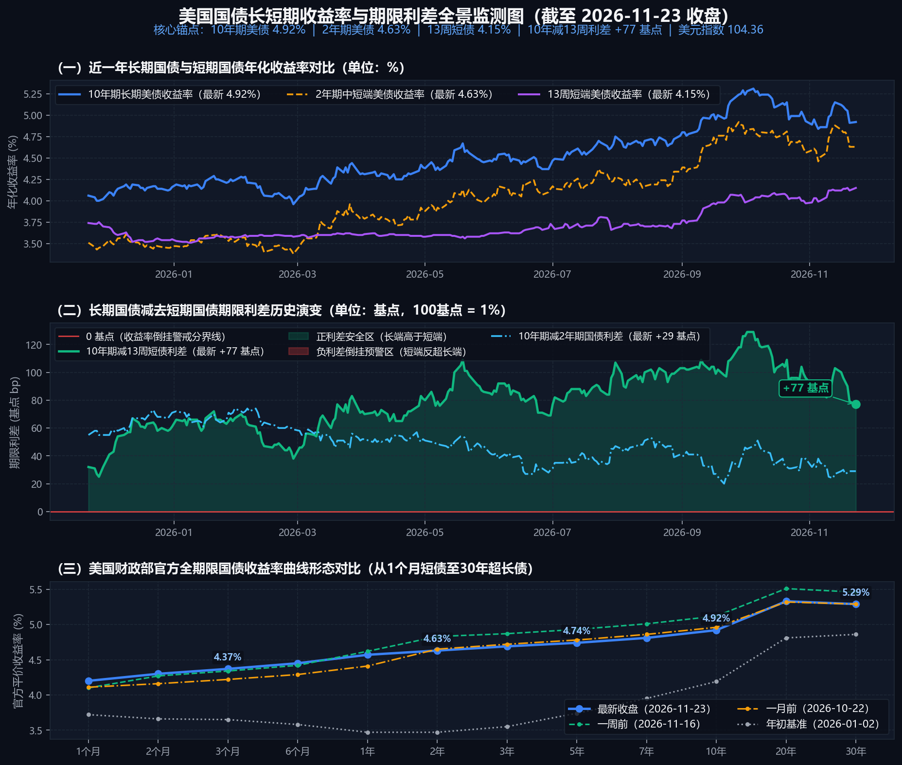

# 美股纳斯达克科技股与核心指数每日投研报告（2026年11月23日）

> **美股交易日期**：2026年11月23日（星期一，正常交易日；北京时间 2026年11月24日凌晨收盘；本周四11月26日感恩节美股将全天休市）  
> **数据与信源口径**：行情与均线波动指标采自雅虎财经日线收盘数据；宏观与监管政策采自央行、部委及美国证监会法定公告（详见专栏文件 [2026-11-23_官方宏观与政策资讯.md](../资讯栏目/2026-11-23_官方宏观与政策资讯.md)）  
> **指标计算说明**：近5日与近20日涨跌幅分别统计最近5个、20个美股交易日累计表现；年初至今涨跌幅以2025年最后一个交易日收盘价为基准；量比（相对成交量）为当日成交量除以过去20个交易日日均成交量。

---

## 一、市场核心综述

2026年11月23日（星期一），美股科技板块在经历连续数周的深度回调后，迎来一场罕见的**超跌逼空与信心全面修复行情**。盘前**英伟达（NVDA）**向美国证监会正式提交高管复职公告，宣布董事会一致投票恢复创始人黄仁勋的首席执行官职务，并获美国政府高层“无国家安全风险”明确背书。这一核心治理危机的解除直接点燃算力产业链买盘，推动纳斯达克综合指数创下 **1991年以来最大开盘涨幅纪录**，四大基准指数全天高开高走：

- **四大指数全线暴涨，芯片板块领跑全场**：**费城半导体指数**单日飙升 **+14.03%** 收于 **9,588.05** 点；**纳斯达克100指数**大涨 **+6.86%** 收报 **26,746.10** 点；**纳斯达克综合指数**跃升 **+6.51%** 收于 **24,089.56** 点；**标普500指数**上涨 **+4.73%** 至 **7,237.17** 点，创下2025年4月以来最佳单日表现。
- **恐慌情绪骤降，但高波动与政策约束仍在**：随着避险情绪迅速退潮，标普500恐慌指数单日暴跌 **25.83%** 回落至 **26.62**，纳指100波动率指数回落 **19.76%** 至 **36.31**；但受美联储10月会议纪要偏鹰派加息讨论制约，10年期美债收益率仍坚守 **4.92%** 高位，黑天鹅偏度指数亦升至 **140.37**，提示机构在追涨同时仍保留尾部防跌保护。
- **个股呈现“算力狂欢”与“并购稀释重挫”的鲜明分化**：19家核心科技股中 **18家收涨（上涨占比 94.7%）**，全样本等权平均大涨 **+7.67%**。**英伟达（+31.48%，量比 2.71倍）** 单日市值激增约9,500亿美元，带动**美光科技（+19.04%）**、**英特尔（+16.34%）**、**特斯拉（+11.46%）**与**帕兰提尔（+11.06%）**领涨；唯独网络安全龙头**众击安全（CRWD，-8.92%，量比 4.59倍）**因宣布439亿美元全股票收购 Zscaler 引发约19%股本稀释担忧，放天量逆势下跌。

---

## 二、四大核心基准指数表现对比

| 指数名称（代码） | 最新收盘点位 | 日内波动区间（最低 ~ 最高） | 单日涨跌 | 近5日涨跌 | 近20日涨跌 | 年初至今 | 20日均线（偏离度） | 50日均线（偏离度） | 200日均线（偏离度） | 量比 | 20日年化波动率 | 距52周高点 |
| :--- | ---: | :---: | ---: | ---: | ---: | ---: | ---: | ---: | ---: | ---: | ---: | ---: |
| **纳斯达克综合指数** (`^IXIC`) | 24,089.56 | 23,794.96 ~ 24,353.65 | **+6.51%** | -1.71% | -7.95% | +3.65% | 24,997.94 (-3.63%) | 26,071.50 (-7.60%) | 25,162.76 (-4.27%) | 1.02倍 | 42.79% | -13.11% |
| **纳斯达克100指数** (`^NDX`) | 26,746.10 | 26,386.42 ~ 27,018.88 | **+6.86%** | -1.66% | -8.63% | +5.93% | 27,767.10 (-3.68%) | 29,176.64 (-8.33%) | 28,081.65 (-4.76%) | 0.26倍* | 47.20% | -14.72% |
| **费城半导体指数** (`^SOX`) | 9,588.05 | 9,374.83 ~ 9,728.12 | **+14.03%** | -0.24% | -13.49% | +35.36% | 10,127.22 (-5.32%) | 11,303.93 (-15.18%) | 10,928.92 (-12.27%) | 不适用 | 96.13% | -34.58% |
| **标普500指数** (`^GSPC`) | 7,237.17 | 7,152.66 ~ 7,295.60 | **+4.73%** | -2.42% | -5.73% | +5.72% | 7,477.25 (-3.21%) | 7,617.60 (-4.99%) | 7,350.10 (-1.54%) | 0.75倍 | 31.92% | -7.74% |

> **指数口径补充说明**：`*` 数据源对纳斯达克100指数披露的单日成交股数统计口径与历史均量口径不一致，观察纳斯达克整体资金换手热度请以**纳斯达克综合指数**（成交 96.18亿股，量比 1.02倍）为准；费城半导体指数为纯价格指数，不含指数级成交量。

---

## 三、多维市场情绪与跨资产风向标

- **综合市场情绪定量评分**：**55.7 / 100 分** —— 当前状态判定为 **「恐慌修复（超跌逼空回暖，但波动仍高）」**
- **内部涨跌与均线温度**：19 家核心科技股中当日 **18 家上涨（占比 94.7%）**；站上20日均线 **3 家**，站上50日均线 **3 家**，站上200日牛熊分界线 **8 家**。
- 期权波动层面：标普500恐慌指数收于 26.62（单日 -25.83%），纳指100波动率指数收于 36.31，科技股相对大盘仍保有 +9.69 点的额外波动溢价。
- 尾部风险层面：黑天鹅偏度指数报 140.37，显示机构防范极端尾部暴跌的对冲需求偏高。
- 利率与美债层面：10年期美债收益率报 4.92%，10年期减13周美债期限利差为 +77 个基点，收益率曲线维持正斜率（未倒挂）。
- 跨资产信用层面：高收益公司债与长期国债比值报 0.9367（单日 -0.05%），长端国债表现强于高收益债，债市资金偏向防御避险。
- **长短期国债利差可视化专刊**：已同步生成最新长短端收益率与期限利差走势图及全期限曲线分析（详见专题报告 [2026-11-23_美债期限利差专题分析.md](../国债利差专题/2026-11-23_美债期限利差专题分析.md) 与交互看板 [美债期限利差看板.html](../交互式看板/美债期限利差看板.html)）。

| 情绪维度分类 | 中文指标名称（代码） | 最新数值 | 单日涨跌幅 | 近5日涨跌幅 | 看盘实战解读 |
| :--- | :--- | ---: | ---: | ---: | :--- |
| 期权恐慌与波动 | **标普500恐慌指数** (`^VIX`) | 26.62 | **-25.83%** | +16.19% | 数值越高代表市场避险恐慌越重，低于20偏乐观，高于30属恐慌区间 |
| 期权恐慌与波动 | **纳指100波动率指数** (`^VXN`) | 36.31 | **-19.76%** | +10.36% | 专门衡量纳斯达克科技权重股的隐含波动与期权对冲热度 |
| 期权恐慌与波动 | **黑天鹅尾部偏度指数** (`^SKEW`) | 140.37 | +1.10% | -4.07% | 衡量机构买入极端暴跌保护期权的意愿，高于140提示尾部防范升温 |
| 汇率与全球流动性 | **美元指数** (`DX-Y.NYB`) | 104.26 | -0.06% | +0.75% | 反映美元对主要货币强弱，走强往往压制跨国科技股海外折算收益 |
| 利率与美联储预期 | **13周美债收益率** (`^IRX`) | 4.15% | +0.61% | +0.53% | 紧贴美联储近期基准利率预期的短端资金利率指标 |
| 利率与美联储预期 | **5年期美债收益率** (`^FVX`) | 4.73% | +0.57% | -4.19% | 反映市场对未来中期利率路径与信贷成本的定价 |
| 利率与美联储预期 | **10年期美债收益率** (`^TNX`) | 4.92% | +0.12% | -3.96% | 全球科技股估值折现之锚，收益率上行直接压制高估值成长股 |
| 利率与美联储预期 | **30年期美债收益率** (`^TYX`) | 5.29% | -0.17% | -3.16% | 反映超长期经济增长、通胀粘性与财政发债供给压力 |
| 避险与通胀预期 | **纽约黄金期货** (`GC=F`) | 3,634.50 | -0.46% | -5.94% | 衡量央行购金、地缘避险需求及实际利率预期 |
| 避险与通胀预期 | **纽约原油期货** (`CL=F`) | 80.00 | -0.21% | -6.99% | 衡量能源通胀输入压力与全球工业活动景气度 |
| 流动性与风险偏好 | **比特币价格** (`BTC-USD`) | 60,283.56 | -1.44% | -4.29% | 全天候交易的高弹性风险资产，反映全球投机流动性松紧 |
| 跨市场广度与轮动 | **罗素2000小盘股指数** (`^RUT`) | 2,669.66 | **+3.40%** | -2.67% | 反映美国本土中小市值企业表现及内需风险偏好 |
| 跨市场广度与轮动 | **道琼斯工业平均指数** (`^DJI`) | 49,595.31 | **+3.01%** | -3.90% | 反映传统工业、金融与消费蓝筹股表现，用于对比科技与价值轮动 |
| 债市信用风险偏好 | **高收益公司债基金** (`HYG`) | 76.52 | +0.25% | -0.27% | 代表高风险企业信用债价格，走强意味着资金愿意承担信用风险 |
| 债市信用风险偏好 | **20年期以上长端美债基金** (`TLT`) | 81.69 | +0.29% | +2.91% | 代表长期国债避险资产价格，与高收益债比值可量化风险偏好 |

---

## 四、官方宏观政策与国际经贸权威资讯精要（零小道消息）

> 完整部委、央行与证监会法定原文链接及深度拆解已归档至专栏文件：[2026-11-23_官方宏观与政策资讯.md](../资讯栏目/2026-11-23_官方宏观与政策资讯.md)。

- **美元利率与美联储动向**：纽约联储最新公布的联邦基金有效利率（EFFR）稳定于 **3.88%**（处于美联储 **3.75%~4.00%** 官方目标区间），担保隔夜融资利率（SOFR）报 **3.92%**；但11月18日公布的美联储10月议息纪要显示几乎所有委员认为若通胀居高不下，后续仍有必要继续**加息**，市场紧盯本周三（11月25日）即将公布的美国三季度 GDP 二次修正值与 PCE 物价指数。
- **国际贸易与半导体出口管制**：美国商务部工业与安全局（BIS）《管控先进半导体远程算力访问》新规已于11月19日正式生效，首次对向受限地区提供超阈值远程云算力的海外数据中心实施全球许可管制，并将新加坡、马来西亚、印尼、泰国、巴西五国列入严控转运许可范围；美国贸易代表办公室同步重申维持301条款及基准关税执法框架。
- **证监会法定公司披露**：11月23日**英伟达**正式提交 8-K 表（条款 5.02）确认黄仁勋复职；同日**众击安全**正式提交 8-K 与 425 表披露超预期三季报及 439 亿美元全股票换股收购 Zscaler 的约束性协议。

---

## 五、核心科技股表现与技术面分板块明细

以下按三大科技子板块分类，组内均按**单日涨跌幅从高到低**排序：

### （一）科技七巨头

| 公司名称（代码） | 收盘价（美元） | 单日涨跌 | 近5日涨跌 | 近20日涨跌 | 年初至今 | 当日成交量 | 量比 | 较20日均线 | 较50日均线 | 较200日均线及趋势位置 | 20日年化波动率 | 距52周高点 |
| :--- | ---: | ---: | ---: | ---: | ---: | ---: | ---: | ---: | ---: | :--- | ---: | ---: |
| **英伟达** (`NVDA`) | 165.05 | **+31.48%** | +5.71% | -23.59% | -11.50% | 7.79亿股 | **2.71倍** | -7.75% | -19.91% | -18.79%｜处于20日、50日与200日三重均线下方 | 136.9% | -32.18% |
| **特斯拉** (`TSLA`) | 385.46 | **+11.46%** | +1.51% | -1.57% | -14.29% | 4697.00万股 | **1.28倍** | +0.25% | +2.47% | +1.03%｜站稳短中长期全部均线 | 74.2% | -22.73% |
| **脸书母公司** (`META`) | 597.60 | **+6.55%** | -4.60% | -5.23% | -9.47% | 1905.17万股 | 0.88倍 | -3.13% | -11.51% | -4.88%｜处于20日、50日与200日三重均线下方 | 47.5% | -23.37% |
| **谷歌母公司** (`GOOGL`) | 282.10 | **+6.34%** | -0.57% | -10.95% | -9.87% | 4425.52万股 | 0.98倍 | -1.95% | -12.11% | -16.23%｜处于20日、50日与200日三重均线下方 | 59.2% | -30.96% |
| **亚马逊** (`AMZN`) | 255.39 | **+3.47%** | -0.92% | +2.53% | +10.64% | 5316.67万股 | 1.00倍 | -0.91% | +0.13% | +4.08%｜守住50日与200日均线，微幅受压20日均线 | 45.7% | -11.08% |
| **苹果** (`AAPL`) | 349.08 | **+1.90%** | -1.05% | +1.50% | +28.40% | 5853.84万股 | 1.18倍 | +0.39% | +2.03% | +14.98%｜站稳短中长期全部均线 | 28.9% | -3.26% |
| **微软** (`MSFT`) | 492.50 | **+1.65%** | -4.92% | -7.53% | +1.84% | 3034.74万股 | 1.01倍 | -5.46% | -5.21% | +10.90%｜守住200日牛熊分界线，受制于20日与50日均线 | 38.6% | -11.92% |

### （二）半导体与芯片设备

| 公司名称（代码） | 收盘价（美元） | 单日涨跌 | 近5日涨跌 | 近20日涨跌 | 年初至今 | 当日成交量 | 量比 | 较20日均线 | 较50日均线 | 较200日均线及趋势位置 | 20日年化波动率 | 距52周高点 |
| :--- | ---: | ---: | ---: | ---: | ---: | ---: | ---: | ---: | ---: | :--- | ---: | ---: |
| **美光科技** (`MU`) | 707.70 | **+19.04%** | -1.57% | -21.69% | +147.96% | 4961.48万股 | **1.47倍** | -8.90% | -22.05% | -8.58%｜处于20日、50日与200日三重均线下方 | 131.8% | -43.61% |
| **英特尔** (`INTC`) | 59.66 | **+16.34%** | +7.55% | -34.06% | +61.68% | 1.65亿股 | 1.07倍 | -5.84% | -33.32% | -31.89%｜处于20日、50日与200日三重均线下方 | 142.8% | -58.09% |
| **高通** (`QCOM`) | 165.38 | **+10.30%** | -1.86% | -7.92% | -3.31% | 2024.09万股 | **1.37倍** | -2.22% | -6.57% | -3.11%｜处于20日、50日与200日三重均线下方 | 81.1% | -36.37% |
| **阿斯麦** (`ASML`) | 1,383.78 | **+9.28%** | -1.64% | -13.02% | +29.34% | 218.24万股 | 1.17倍 | -6.61% | -14.63% | -13.59%｜处于20日、50日与200日三重均线下方 | 73.4% | -30.81% |
| **超威半导体** (`AMD`) | 453.46 | **+6.85%** | -10.08% | -14.65% | +111.74% | 5383.75万股 | **1.27倍** | -10.24% | -17.90% | +5.21%｜守住200日牛熊分界线，受制于20日与50日均线 | 133.0% | -31.14% |
| **博通** (`AVGO`) | 313.55 | **+3.00%** | -5.95% | -4.75% | -9.40% | 4100.93万股 | **1.35倍** | -5.44% | -8.34% | -14.73%｜处于20日、50日与200日三重均线下方 | 84.6% | -36.66% |

### （三）软件、云计算与网络安全

| 公司名称（代码） | 收盘价（美元） | 单日涨跌 | 近5日涨跌 | 近20日涨跌 | 年初至今 | 当日成交量 | 量比 | 较20日均线 | 较50日均线 | 较200日均线及趋势位置 | 20日年化波动率 | 距52周高点 |
| :--- | ---: | ---: | ---: | ---: | ---: | ---: | ---: | ---: | ---: | :--- | ---: | ---: |
| **帕兰提尔** (`PLTR`) | 159.36 | **+11.06%** | -0.64% | -19.86% | -10.35% | 3201.08万股 | **1.28倍** | -6.18% | -12.91% | +3.42%｜守住200日牛熊分界线，受制于20日与50日均线 | 70.9% | -25.16% |
| **新思科技** (`SNPS`) | 426.99 | **+7.78%** | -3.25% | -6.02% | -9.10% | 152.19万股 | 0.81倍 | -5.83% | -4.98% | -3.16%｜处于20日、50日与200日三重均线下方 | 55.3% | -20.85% |
| **派拓网络** (`PANW`) | 353.43 | **+2.94%** | +11.81% | -9.48% | +91.87% | 1017.20万股 | **1.31倍** | +2.72% | -3.70% | +25.17%｜站稳20日与200日均线，挑战50日均线 | 70.5% | -18.25% |
| **奥多比** (`ADBE`) | 223.98 | **+2.88%** | -8.95% | -13.39% | -36.00% | 390.56万股 | 0.98倍 | -6.53% | -7.79% | -9.00%｜处于20日、50日与200日三重均线下方 | 32.1% | -38.25% |
| **奈飞** (`NFLX`) | 58.10 | **+2.41%** | -4.36% | -9.08% | -38.03% | 5067.10万股 | 1.23倍 | -6.28% | -13.23% | -27.21%｜处于20日、50日与200日三重均线下方 | 32.9% | -47.05% |
| **众击安全** (`CRWD`) | 208.97 | **-8.92%** | -6.38% | -20.19% | +78.32% | 4231.33万股 | **4.59倍** | -11.25% | -15.23% | +18.23%｜守住200日牛熊分界线，受制于20日与50日均线 | 67.3% | -27.19% |

> **全样本涨跌极值榜**：领涨前五依次为 **英伟达 (+31.48%) > 美光科技 (+19.04%) > 英特尔 (+16.34%) > 特斯拉 (+11.46%) > 帕兰提尔 (+11.06%)**；表现靠后五家依次为 **众击安全 (-8.92%) < 微软 (+1.65%) < 苹果 (+1.90%) < 奈飞 (+2.41%) < 奥多比 (+2.88%)**。

---

## 六、子板块轮动与市场广度量化分析

| 子板块名称 | 样本数 | 上涨家数（占比） | 等权单日均值 | 单日中位数 | 等权近5日均值 | 等权近20日均值 | 等权年初至今均值 | 站上20日均线 | 站上50日均线 | 站上200日均线 |
| :--- | :---: | :---: | ---: | ---: | ---: | ---: | ---: | :---: | :---: | :---: |
| 半导体与芯片设备 | 6 | 6 / 6 (100.0%) | **+10.80%** | +9.79% | -2.26% | -16.02% | +56.34% | 0 / 6 (0.0%) | 0 / 6 (0.0%) | 1 / 6 (16.7%) |
| 科技七巨头 | 7 | 7 / 7 (100.0%) | **+8.98%** | +6.34% | -0.69% | -6.41% | -0.61% | 2 / 7 (28.6%) | 3 / 7 (42.9%) | 4 / 7 (57.1%) |
| 软件、云计算与网安 | 6 | 5 / 6 (83.3%) | **+3.03%** | +2.91% | -1.96% | -13.00% | +12.79% | 1 / 6 (16.7%) | 0 / 6 (0.0%) | 3 / 6 (50.0%) |
| **全部19家核心科技股合计** | 19 | 18 / 19 (94.7%) | **+7.67%** | +6.55% | -1.59% | -11.52% | +21.60% | 3 / 19 (15.8%) | 3 / 19 (15.8%) | 8 / 19 (42.1%) |

1. **高弹性算力与存储链领衔反攻，稳健防御型巨头相对滞涨**：此前近20个交易日回撤最深的**半导体与芯片设备板块**（近20日等权跌 -16.02%）成为当日空头回补主战场，6家公司全线收涨、等权单日涨幅高达 **+10.80%**；反观前期抗跌的稳健现金流龙头**苹果（+1.90%）**与**微软（+1.65%）**，在资金大举涌向高弹性品种时涨幅明显落后于指数。
2. **单日广度极强但中期均线修复尚未完成**：尽管当日上涨广度高达 **94.7%**，但从均线趋势看，19家样本股中仍有 **16家（84.2%）位于20日与50日均线下方**，其中半导体板块站上20日与50日均线的家数依然是 **0家**。这表明周一的长阳本质上属于极端超卖后的首轮情绪修复，中期下降通道尚未彻底扭转。
3. **网络安全双雄因并购筹码结构差异而剧烈分化**：**众击安全（-8.92%）**受大额全股票并购带来的股本摊薄拖累重挫，拉低软件板块等权涨幅至 **+3.03%**；而竞争对手**派拓网络（+2.94%，近5日累计 +11.81%）**凭借上周优异财报及无大额稀释优势承接了板块避险资金，稳居近5日全样本涨幅榜首。

---

## 七、成交量异动与均线结构信号

### （一）显著放量异动个股（20日量比 ≥ 1.25倍）

- **众击安全（CRWD｜量比 4.59倍｜单日 -8.92%）**：全日狂飙至 4,231.33 万股（过去20日均量仅 921.55 万股），天量长阴直接击穿20日与50日均线，盘中最低触及 200.53 美元整数关口，目前仅依靠200日均线（176.74美元）提供长期支撑。
- **英伟达（NVDA｜量比 2.71倍｜单日 +31.48%）**：单日成交高达 7.79 亿股，资金承接极为踊跃，股价自上周五52周收盘低点（125.53美元）暴力拉升至 165.05 美元，上方即将面临20日均线（178.91美元）的套牢盘检验。
- **美光科技（MU｜量比 1.47倍｜+19.04%）与高通（QCOM｜量比 1.37倍｜+10.30%）**：同步放量长阳反抽，其中高通收盘价距离20日均线仅差 -2.22%，具备率先收复短期均线的潜力。
- **博通（AVGO｜量比 1.35倍｜+3.00%）与超威半导体（AMD｜量比 1.27倍｜+6.85%）**：两者虽放量跟涨，但涨幅明显落后于费城半导体指数（+14.03%），显示上方短线解套抛压较重。
- **特斯拉（TSLA｜量比 1.28倍｜+11.46%）与帕兰提尔（PLTR｜量比 1.28倍｜+11.06%）**：双双放量突破关键均线——特斯拉单日一根长阳同时收复20日、50日与200日三条均线；帕兰提尔则重新夺回200日牛熊分界线（154.09美元）。

### （二）关键均线攻防与波动率警示

- **全均线多头标的仅存两席**：截至收盘，19家样本公司中仅有**苹果**与**特斯拉**两家同时站在20日、50日与200日三重均线之上，趋势结构最为完好。
- **芯片股波动率仍处历史极值区间**：英特尔（142.8%）、英伟达（136.9%）、超威半导体（133.0%）、美光科技（131.8%）的20日年化波动率全部突破 130%，费城半导体指数年化波动率亦高达 **96.13%**，意味着短期日内震荡幅度仍将远超常态。

---

## 八、重点个股催化剖析与短期风险展望

### （一）重点异动个股驱动逻辑（区分法定事实与市场博弈）

- **英伟达（+31.48%）**：核心驱动力为公司向美国证监会提交的黄仁勋复职 8-K 法定公告及白宫安全背书，彻底消除了困扰算力龙头的管理层真空。
- **众击安全（-8.92%）**：基本面三季报营收与净新增年度经常性收入双双创纪录并上调指引，但高达439亿美元的全股票收购 Zscaler 方案需增发约1.91亿股新股（摊薄现有股东权益约19%），引发机构对并购估值与整合难度的集中避险。
- **美光科技（+19.04%）、英特尔（+16.34%）、高通（+10.30%）、阿斯麦（+9.28%）**：受益于人工智能数据中心投资信心修复与前期深度超跌后的空头回补；其中英特尔叠加此前官方宣布 18A-P 先进制程斩获首个外部代工客户的利好延续，近5日逆势累涨 +7.55%。
- **特斯拉（+11.46%）、帕兰提尔（+11.06%）、新思科技（+7.78%）**：高弹性科技成长股随大盘风险偏好反转大幅上扬，资金回补前期跌幅较大的软件与智能驾驶龙头。
- **脸书母公司（+6.55%）、谷歌母公司（+6.34%）、亚马逊（+3.47%）**：超大规模云厂商随人工智能基础设施情绪回暖同步修复估值。

### （二）短期交易窗口与核心风险展望

1. **感恩节假期前的官方通胀大考**：本周四（11月26日）感恩节休市、周五提前半日收盘，节前交投流动性将逐步回落。周三（11月25日）美国经济分析局将正式公布**三季度 GDP 二次修正值与 PCE 物价指数**，若核心通胀超预期走高，可能推升12月美联储加息预期并令接近 5% 的10年期美债收益率再度施压科技股。
2. **重点观察 20日均线与 200日均线阻力突破有效性**：标普500指数距200日均线仅剩 -1.54%，纳斯达克综合指数距20日均线为 -3.63%。未来两个交易日若能温和放量站稳均线上方，方能确认中期阶段性底部成立；反之若缩量冲高受阻，需提防空头回补结束后的二次回踩。
3. **跟踪出口管制细则与并购消化情况**：持续留意半导体企业在商务部远程算力管制新规生效后的合规指引更新，以及众击安全在 200 美元整数关口与 200日均线（176.74美元）之间的机构筹码沉淀情况。

---

## 九、初学者投研术语通俗伴读

> 以下词条由系统根据今日报告正文自动识别生成，帮助初学者无障碍读懂专业数据。当前已设置免解释的名词共 **0** 个；今后若某个名词您已完全熟悉、不再需要解释，只需直接告诉我（例如“以后不用解释均线和量比了”），系统便会将其写入《术语配置.json》永久跳过。

| 所属类别 | 专业术语名称 | 通俗中文解释 | 看盘实战意义 |
| :--- | :--- | :--- | :--- |
| 宏观与货币政策 | **美联储与联邦公开市场委员会（FOMC）** | 美联储是美国的中央银行，而联邦公开市场委员会（简称 FOMC）是美联储内部专门决定“美元基准利率涨跌”的核心决策机构，每年通常召开 8 次例会。 | 全球资金成本都看它脸色：一旦委员会态度强硬（市场俗称“鹰派”），意味着利率可能维持高位甚至继续加息，科技股往往承压；态度温和（俗称“鸽派”），则利好科技股估值扩张。 |
| 宏观与货币政策 | **加息、降息与联邦基金利率** | 联邦基金利率是美国商业银行之间隔夜拆借美元的基准利率。调高该利率即“加息”，意在给过热经济和物价降温；调低即“降息”（或减息），意在降低企业和个人借钱成本、刺激经济。 | 科技成长股大量利润来自未来数年，利率越高，未来利润折算到今天的价值就越低。因此“预期加息”通常压制纳斯达克，“预期降息”则提振纳斯达克。 |
| 宏观与货币政策 | **基点（bp）** | 金融市场用来衡量利率微幅变动的最小常用单位。1 个基点等于 0.01%（即万分之一），100 个基点等于 1 个百分点（1%）。 | 例如常说的“美联储加息 25 个基点”，就是把基准利率上调 0.25%；“美债收益率跳升 10 个基点”，代表借债成本上升了 0.10%。 |
| 宏观与货币政策 | **担保隔夜融资利率（SOFR）** | 金融机构以美国国债作为抵押物、向市场借入隔夜美元现金的实际利率，由纽约联储每日官方公布。 | 它是观察美元金融体系“钱荒与否”的最真实温度计：若该利率突然大幅高于美联储利率区间上限，说明市场短期现金流动性吃紧。 |
| 宏观与货币政策 | **10年期美债收益率** | 投资者购买并持有美国政府 10 年期国债所能获得的年化回报率，被华尔街公认为“全球资产定价之锚”。 | 由于美国国债几乎没有违约风险，当 10 年期美债收益率接近或突破 5% 时，大量稳健资金会觉得“躺赚 5% 利息很划算”，从而减少对高估值科技股的配置。 |
| 宏观与货币政策 | **美债期限利差（收益率曲线与倒挂）** | 用长期国债收益率减去短期国债收益率得到的差值（常见有“10年期减13周短债”和“10年期减2年期国债”）。正常情况下借钱时间越长，要求的利息补偿越高，利差为正数；若短期利率反超长期利率（利差变成负数），就叫“收益率倒挂”。 | 利差保持正数且温和走阔，通常说明市场预期经济维持正增长或长期通胀有溢价；若利差由正转负陷入深度倒挂，历史上往往是美联储加息过猛、未来经济面临降温甚至衰退的经典预警。 |
| 宏观与货币政策 | **美元指数** | 综合反映美元在国际外汇市场上对欧元、日元、英镑等一篮子主要货币强弱程度的指标。 | 苹果、英伟达、微软等纳斯达克巨头有一半左右收入来自海外。美元指数过强不仅代表全球美元回流美国本土、新兴市场承压，也会让跨国科技公司的海外收入换算回美元时缩水。 |
| 宏观与货币政策 | **个人消费支出物价指数（PCE）与消费者物价指数（CPI）** | 两者都是衡量美国物价上涨速度（通货膨胀）的官方指标。其中剔除食品和能源波动后的“核心 PCE 物价指数”，是美联储决定是否加息或降息时最看重的头号通胀依据。 | 只要核心 PCE 年化涨幅明显高于美联储设定的 2% 目标，美联储就很难放心降息。 |
| 宏观与货币政策 | **国内生产总值（GDP）与修正值** | 衡量一个国家在特定季度或年度内生产的所有最终商品和服务总价值，代表经济增长快慢。美国经济分析局对每季数据会先后发布初值、二次修正值和终值。 | 科技股最喜欢“经济温和增长 + 通胀回落”的环境；若经济增长骤降但物价居高不下（俗称“类滞胀”），股市往往剧烈波动。 |
| 国际经贸与监管 | **301条款关税与贸易代表办公室（USTR）** | 美国贸易代表办公室是负责对外贸易谈判与关税政策的总统直属机构；“301条款”则是美国贸易法授权政府对被认定存在“不公平贸易做法”的贸易伙伴加征特别关税的法律工具。 | 关税调升会直接推高跨国硬件、消费电子、服务器及汽车供应链的进口成本，并可能引发贸易伙伴反制。 |
| 国际经贸与监管 | **出口管制、工业与安全局（BIS）及实体清单** | 美国商务部下属的工业与安全局负责管理高科技产品出口许可。被列入“实体清单”或受限地区的海外机构，未经美国政府特别批准，无法购买美国高端芯片、软件或租用受限的远程云计算算力。 | 半导体公司（如英伟达、超威半导体、阿斯麦等）在海外拥有可观收入，出口管制范围的收紧或放宽会直接影响它们的订单预期。 |
| 国际经贸与监管 | **美国证监会 8-K 重大事项法定公告** | 美国证券交易委员会规定，美股上市公司一旦发生可能显著影响股价的重大事件（如收购兼并、核心高管辞职或复职、正式发布财报等），必须在 4 个工作日内提交的官方披露文件。 | 相比社交媒体传闻或小道消息，8-K 文件具有严格法律效力，造假需承担刑事责任，是核实公司重大变动的最高权威一手信源。 |
| 市场情绪与交易机制 | **恐慌指数（VIX）与纳指波动率指数（VXN）** | 通过期权价格推算出来的未来 30 天市场预期波动幅度。VIX 对应标普500大盘，VXN 则专门对应纳斯达克100科技股。 | 数值越低（如低于 18）代表市场平静乐观；突破 25 代表市场紧张不安；突破 35 往往代表极度恐慌抛售。当恐慌指数从高位单日暴跌逾 20% 时，通常意味着恐慌警报暂时解除、资金大举回流股市。 |
| 市场情绪与交易机制 | **黑天鹅偏度指数（SKEW）** | 衡量机构投资者在期权市场上花多少钱购买“防范大盘极端暴跌”保险的指标，正常区间通常在 100 至 135 之间。 | 当该数值升至 140 以上时，说明尽管指数可能在涨，华尔街大资金暗地里仍在加买“防暴跌保险”，提示需留一份清醒。 |
| 市场情绪与交易机制 | **信用风险偏好比值（高收益债与长端国债比值）** | 比较“高收益企业债基金（HYG，风险较高、利息高）”与“长期美国国债基金（TLT，安全避险）”的价格比值。 | 债市资金往往比股市更敏锐：比值上升说明聪明钱愿意承担企业违约风险、整体市场偏向进攻；比值大跌则说明资金正在撤退回国债避险。 |
| 市场情绪与交易机制 | **空头回补（逼空行情）** | 此前看跌某只股票的投资者会先“借入股票卖出”（即做空），等跌下来再买回还掉赚差价。如果突然出现重大利好导致股价暴涨，做空者为防止巨额亏损被迫不计成本紧急买回股票平仓，这种集中买入会进一步把股价推得更高。 | 熊市或大跌后的单日暴涨（例如单日涨超 10%~30%），往往包含大量空头被迫止损买回的力量，爆发力极强但后续需要真实长线买盘接力。 |
| 市场情绪与交易机制 | **市场广度（上涨家数占比）** | 统计指数上涨时，内部究竟是“绝大多数成分股一起涨”，还是“只有两三只超级大盘股拉动指数、其余股票都在跌”。 | 健康的上涨需要高市场广度（如超过 70%~80% 的股票同步上涨且站上均线）；若只有少数权重股独涨，行情通常走不远。 |
| 市场情绪与交易机制 | **高弹性股票（高贝塔 / 高 Beta）** | 衡量个股相对大盘涨跌放大倍数的指标。大盘涨 1% 时往往能涨 2%~3%、大盘跌 1% 时也跌得更猛的股票，称为高弹性（高贝塔）标的，典型代表如半导体、人工智能软件股。 | 当市场情绪转暖反攻时，高弹性股票是冲锋主力；当市场避险下跌时，稳健型股票（如苹果）则更抗跌。 |
| 技术分析与量化指标 | **移动平均线（20日、50日、200日均线）与均线偏离度** | 把过去 20 个、50 个或 200 个交易日的收盘价算出的平均价格，分别代表短期（约一个月）、中期（约一个季度）和长期（约一年）的市场平均持仓成本。当前股价高于或低于均线的百分比即为“均线偏离度”。 | 股价站上均线说明近期买入的人普遍赚钱，均线会形成支撑；反之股价跌破均线，上方套牢盘在反弹到均线附近时容易卖出解套，均线就变成了阻力位。其中 200 日均线常被称为“牛熊分界线”。 |
| 技术分析与量化指标 | **相对成交量（量比）** | 当日成交股数除以过去 20 个交易日平均每日成交股数的倍数。1.0 倍代表成交平平；超过 1.25 倍代表明显放量；超过 2 倍以上属于巨量异动。 | 俗话说“股市里什么都能骗人，唯独成交量不会”：放量大涨说明真金白银在抢筹，放量大跌则说明机构资金正在集中撤离。 |
| 技术分析与量化指标 | **20日年化波动率** | 根据最近 20 个交易日每天涨跌幅的剧烈程度，按全年约 252 个交易日折算出的年度价格摆动幅度指标。 | 普通稳健大盘股的年化波动率多在 20%~35% 左右；如果某只股票年化波动率高达 100% 以上，说明它近期每天暴涨暴跌如同过山车，仓位控制必须格外谨慎。 |
| 技术分析与量化指标 | **距52周高点回撤** | 当前收盘价相比过去一年（52周）最高价格下跌了多少百分比。 | 通常回撤在 10% 以内属于正常震荡，回撤 10%~20% 称为“技术性回调”，回撤超过 20% 则进入个股或板块层面的“技术性熊市/深度修正区间”。 |
| 科技与财报基本面 | **年度经常性收入（ARR）** | 云计算与网络安全软件公司最核心的业绩指标，指客户按年签订订阅合同所带来的可重复、可预测的年度合同收入；“净新增 ARR”则是单季度新签减去流失后的净增加额。 | 软件公司不靠一锤子买卖，只要 ARR 保持高速增长，未来几年的现金流就非常稳固。 |
| 科技与财报基本面 | **全股票收购与股本稀释** | 收购方不掏现金，而是向被收购公司的股东“新印一批自家股票”来完成并购。由于总股数变多了，原有老股东手中每一股所占公司的分红和投票权比例就会被摊薄，称为“股本稀释”。 | 在大型全股票并购宣布当天，收购方股价往往会因为老股东担心“股份被摊薄、收购出价太贵或整合困难”而出现短期大跌。 |
| 科技与财报基本面 | **资本开支（CapEx）与超大规模云厂商** | 超大规模云厂商指微软、亚马逊、谷歌、脸书母公司这类运营全球巨型数据中心的科技巨头；它们每年斥巨资购买人工智能芯片、服务器和电力设施的投入就叫“资本开支”。 | 云巨头的资本开支正是英伟达、博通、美光等半导体公司的直接收入来源——云巨头越舍得花钱建数据中心，芯片股业绩就越强；但若花钱太多却迟迟赚不到软件收入，云巨头自身股价就会受质疑。 |
| 科技与财报基本面 | **先进制程（如18A）与定制人工智能芯片（TPU/ASIC）** | 制程代表芯片内部晶体管的精细程度（18A 约等于 1.8 纳米级别，数字越小越先进、越省电且算力越强）；TPU 则是谷歌联合博通等厂商专门为自家人工智能任务量身定制的专用算力芯片，用以补充英伟达的通用芯片。 | 谁能率先量产良率合格的先进制程或拿到云巨头定制芯片大单，谁就能在人工智能硬件竞争中分走高额利润。 |
