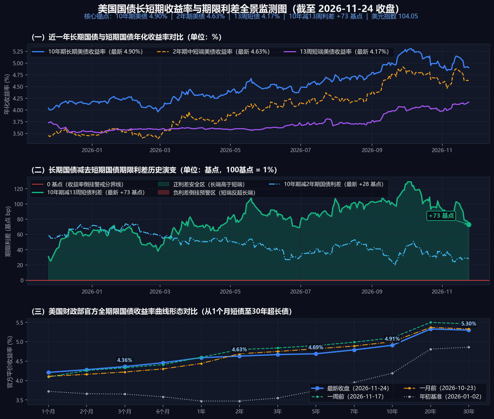

# 美股纳斯达克科技股与核心指数每日投研报告（2026年11月24日）

> **美股交易日期**：2026年11月24日（星期二，美股最新收盘交易日；11月25日盘前经济分析局将发布三季度 GDP 二次修正值与10月 PCE 物价数据；11月26日感恩节美股全天休市，11月27日提前收盘）  
> **数据与信源口径**：行情与均线波动指标采自雅虎财经日线收盘数据；宏观与监管政策采自央行、部委及美国证监会法定公告（详见专栏文件 [2026-11-24_官方宏观与政策资讯.md](../资讯栏目/2026-11-24_官方宏观与政策资讯.md)）  
> **指标计算说明**：近5日与近20日涨跌幅分别统计最近5个、20个美股交易日累计表现；年初至今涨跌幅以2025年最后一个交易日收盘价为基准；量比（相对成交量）为当日成交量除以过去20个交易日日均成交量。

---

## 一、市场核心综述

美东时间 2026年11月24日（星期二），在经历周一超级逼空大涨后，美股盘面出现显著的**获利回吐与高切低轮动**，芯片硬件板块普遍深幅回调，综合市场情绪评分回落至 **31.9 分（偏空谨慎｜波动高企、均线承压）**：

- **科技与芯片指数承压，道指逆势突破五万点大关**：**费城半导体指数**单日大跌 **-7.88%** 收于 **8,832.50** 点，回吐周一过半涨幅；**纳斯达克100指数**收跌 **-1.99%** 报 **26,214.17** 点，**纳斯达克综合指数**下跌 **-1.48%** 收报 **23,733.54** 点；而**标普500指数**仅微跌 **-0.50%** 至 **7,201.09** 点，传统蓝筹**道琼斯工业平均指数**逆势上涨 **+0.85%** 收报 **50,018.70** 点，资金明显向低估值工业、消费与稳健软件资产轮动。
- **市场广度回落，波动率溢价维持高位**：19家核心科技股中仅 **6 家收涨（占比 31.6%）**，全样本等权单日下跌 **-2.06%**。期权层面，标普500恐慌指数微降 **-0.98%** 至 **26.36**，而纳指100波动率指数逆势微升 **+0.30%** 至 **36.42**，科技股相对大盘仍保有 **+10.06 点** 额外波动溢价；10年期美债收益率微降至 **4.90%**（10年期减13周利差 **+73 基点**）。
- **盘面显著分化：软件与防御巨头飘红，存储与算力芯片领跌**：受前期大涨后获利了结及美国商务部新增7家东南亚实体清单出口管制落地影响，半导体板块 6 家样本股全线收跌，**美光科技（-11.01%）**、**超威半导体（-8.86%）**、**英特尔（-8.15%）** 与 **英伟达（-5.86%）** 领跌；反观软件与防御龙头逆势走强，**奥多比（+3.62%）**、**苹果（+1.43%）**、**奈飞（+1.33%）**、**帕兰提尔（+1.14%）** 与 **众击安全（+0.90%）** 录得正收益。

---

## 二、四大核心基准指数表现对比

| 指数名称（代码） | 最新收盘点位 | 日内波动区间（最低 ~ 最高） | 单日涨跌 | 近5日涨跌 | 近20日涨跌 | 年初至今 | 20日均线（偏离度） | 50日均线（偏离度） | 200日均线（偏离度） | 量比 | 20日年化波动率 | 距52周高点 |
| :--- | ---: | :---: | ---: | ---: | ---: | ---: | ---: | ---: | ---: | ---: | ---: | ---: |
| **纳斯达克综合指数** (`^IXIC`) | 23,733.54 | 23,455.84 ~ 23,884.74 | **-1.48%** | -2.45% | -10.36% | +2.11% | 24,860.72 (-4.53%) | 26,026.54 (-8.81%) | 25,165.23 (-5.69%) | 0.96倍 | 42.55% | -14.39% |
| **纳斯达克100指数** (`^NDX`) | 26,214.17 | 25,935.47 ~ 26,433.60 | **-1.99%** | -2.92% | -11.59% | +3.82% | 27,595.23 (-5.00%) | 29,122.17 (-9.99%) | 28,086.38 (-6.67%) | 0.96倍* | 47.07% | -16.41% |
| **费城半导体指数** (`^SOX`) | 8,832.50 | 8,657.78 ~ 9,197.55 | **-7.88%** | -8.40% | -23.08% | +24.70% | 9,994.72 (-11.63%) | 11,257.07 (-21.54%) | 10,932.26 (-19.21%) | 不适用 | 98.17% | -39.73% |
| **标普500指数** (`^GSPC`) | 7,201.09 | 7,138.93 ~ 7,223.95 | **-0.50%** | -1.90% | -6.75% | +5.19% | 7,451.18 (-3.36%) | 7,609.91 (-5.37%) | 7,351.29 (-2.04%) | 0.93倍 | 31.76% | -8.20% |

> **指数口径补充说明**：`*` 数据源对纳斯达克100指数披露的单日成交股数统计口径与历史均量口径不一致，观察纳斯达克整体资金换手热度请以**纳斯达克综合指数**（成交 92.22亿股，量比 0.96倍）为准；费城半导体指数为纯价格指数，不含指数级成交量。

---

## 三、多维市场情绪与跨资产风向标

- **综合市场情绪定量评分**：**31.9 / 100 分** —— 当前状态判定为 **「偏空谨慎（波动高企、均线承压）」**
- **内部涨跌与均线温度**：19 家核心科技股中当日 **6 家上涨（占比 31.6%）**；站上20日均线 **3 家**，站上50日均线 **2 家**，站上200日牛熊分界线 **7 家**。
- 期权波动层面：标普500恐慌指数收于 26.36（单日 -0.98%），纳指100波动率指数收于 36.42，科技股相对大盘仍保有 +10.06 点的额外波动溢价。
- 尾部风险层面：黑天鹅偏度指数报 139.16，显示尾部黑天鹅对冲需求处于常态区间。
- 利率与美债层面：10年期美债收益率报 4.90%，10年期减13周美债期限利差为 +73 个基点，收益率曲线维持正斜率（未倒挂）。
- 跨资产信用层面：高收益公司债与长期国债比值报 0.9379（单日 +0.13%），信用债表现优于长端国债，债市资金偏向承担风险。
- **长短期国债利差可视化专刊**：已同步生成最新长短端收益率与期限利差走势图及全期限曲线分析（详见专题报告 [2026-11-24_美债期限利差专题分析.md](../国债利差专题/2026-11-24_美债期限利差专题分析.md) 与交互看板 [美债期限利差看板.html](../交互式看板/美债期限利差看板.html)）。

| 情绪维度分类 | 中文指标名称（代码） | 最新数值 | 单日涨跌幅 | 近5日涨跌幅 | 看盘实战解读 |
| :--- | :--- | ---: | ---: | ---: | :--- |
| 期权恐慌与波动 | **标普500恐慌指数** (`^VIX`) | 26.36 | -0.98% | +3.53% | 数值越高代表市场避险恐慌越重，低于20偏乐观，高于30属恐慌区间 |
| 期权恐慌与波动 | **纳指100波动率指数** (`^VXN`) | 36.42 | +0.30% | +5.75% | 专门衡量纳斯达克科技权重股的隐含波动与期权对冲热度 |
| 期权恐慌与波动 | **黑天鹅尾部偏度指数** (`^SKEW`) | 139.16 | -0.86% | -4.10% | 衡量机构买入极端暴跌保护期权的意愿，高于140提示尾部防范升温 |
| 汇率与全球流动性 | **美元指数** (`DX-Y.NYB`) | 104.05 | +0.23% | +0.19% | 反映美元对主要货币强弱，走强往往压制跨国科技股海外折算收益 |
| 利率与美联储预期 | **13周美债收益率** (`^IRX`) | 4.17% | +0.51% | +0.72% | 紧贴美联储近期基准利率预期的短端资金利率指标 |
| 利率与美联储预期 | **5年期美债收益率** (`^FVX`) | 4.71% | -0.34% | -3.84% | 反映市场对未来中期利率路径与信贷成本的定价 |
| 利率与美联储预期 | **10年期美债收益率** (`^TNX`) | 4.90% | -0.28% | -3.90% | 全球科技股估值折现之锚，收益率上行直接压制高估值成长股 |
| 利率与美联储预期 | **30年期美债收益率** (`^TYX`) | 5.29% | -0.04% | -3.04% | 反映超长期经济增长、通胀粘性与财政发债供给压力 |
| 避险与通胀预期 | **纽约黄金期货** (`GC=F`) | 3,525.10 | -1.03% | -5.79% | 衡量央行购金、地缘避险需求及实际利率预期 |
| 避险与通胀预期 | **纽约原油期货** (`CL=F`) | 80.24 | -2.21% | -3.63% | 衡量能源通胀输入压力与全球工业活动景气度 |
| 流动性与风险偏好 | **比特币价格** (`BTC-USD`) | 58,793.39 | -1.60% | -0.01% | 全天候交易的高弹性风险资产，反映全球投机流动性松紧 |
| 跨市场广度与轮动 | **罗素2000小盘股指数** (`^RUT`) | 2,684.94 | +0.57% | -0.63% | 反映美国本土中小市值企业表现及内需风险偏好 |
| 跨市场广度与轮动 | **道琼斯工业平均指数** (`^DJI`) | 50,018.70 | +0.85% | -1.46% | 反映传统工业、金融与消费蓝筹股表现，用于对比科技与价值轮动 |
| 债市信用风险偏好 | **高收益公司债基金** (`HYG`) | 76.43 | -0.12% | -0.26% | 代表高风险企业信用债价格，走强意味着资金愿意承担信用风险 |
| 债市信用风险偏好 | **20年期以上长端美债基金** (`TLT`) | 81.49 | -0.24% | +2.44% | 代表长期国债避险资产价格，与高收益债比值可量化风险偏好 |

---

## 四、官方宏观政策与国际经贸权威资讯精要（零小道消息）

> 完整部委、央行与证监会法定原文链接及深度拆解已归档至专栏文件：[2026-11-24_官方宏观与政策资讯.md](../资讯栏目/2026-11-24_官方宏观与政策资讯.md)。

- **美元利率与美联储动态**：纽约联储最新公布的联邦基金有效利率（EFFR）稳定于 **3.88%**（生效日 11月23日），担保隔夜融资利率（SOFR）报 **3.92%**；11月24日美联储正式公布10月19日及28日贴现率会议纪要，披露在10月议息会议前，**全美 12 家地区联储中有 8 家董事会曾建议将贴现窗口初级信贷利率上调 25 个基点至 4.25%**（理事会最终维持未变），进一步印证美联储体系内偏鹰派的利率警惕态度；市场正紧盯11月25日（周三美东 8:30）美国经济分析局即将发布的三季度 GDP 二次修正值与 10 月 PCE 物价指数。
- **国际贸易与半导体出口管制**：美国商务部工业与安全局（BIS）最新《实体清单增补最终规则》（联邦公报编号 `2026-23999`，11月23日公示生效、11月25日正式刊印）正式将位于**马来西亚、新加坡、泰国的 7 家实体**列入出口管制实体清单，直指先进计算与人工智能芯片转运合规风险，相关出口许可申请适用“推定拒绝”原则。
- **证监会法定公司披露**：11月24日，**高通（QCOM）**提交 `8-K` 公告披露董事会向核心高管授予与 250~500 美元股价挂钩的长期“价值创造”绩效股权激励；**谷歌母公司（GOOGL）**提交 `8-K` 公告披露完成 **60 亿加元** 四期优先票据公开发行交割（2029至2066年到期）；**美光科技（MU）**提交 2026 财年年报（`10-K`）；**众击安全（CRWD）**续发 `425` 法定并购沟通文件推进收购 Zscaler 交易。

---

## 五、核心科技股表现与技术面分板块明细

以下按三大科技子板块分类，组内均按**单日涨跌幅从高到低**排序：

### （一）科技七巨头

| 公司名称（代码） | 收盘价（美元） | 单日涨跌 | 近5日涨跌 | 近20日涨跌 | 年初至今 | 当日成交量 | 量比 | 较20日均线 | 较50日均线 | 较200日均线及趋势位置 | 20日年化波动率 | 距52周高点 |
| :--- | ---: | ---: | ---: | ---: | ---: | ---: | ---: | ---: | ---: | :--- | ---: | ---: |
| **苹果** (`AAPL`) | 354.07 | **+1.43%** | +0.61% | +2.01% | +30.24% | 4121.42万股 | 0.82倍 | +1.72% | +3.35% | +16.47%｜站稳短中长期全部均线 | 29.1% | -1.87% |
| **微软** (`MSFT`) | 496.13 | **+0.74%** | -2.00% | -6.62% | +2.59% | 2308.69万股 | 0.76倍 | -4.44% | -4.51% | +11.61%｜守住200日牛熊分界线，受制于20日与50日均线 | 38.8% | -11.27% |
| **特斯拉** (`TSLA`) | 384.68 | **-0.20%** | +1.20% | -5.59% | -14.46% | 2869.76万股 | 0.79倍 | +0.35% | +2.11% | +0.87%｜站稳短中长期全部均线 | 72.6% | -22.88% |
| **谷歌母公司** (`GOOGL`) | 279.05 | **-1.08%** | -0.41% | -12.95% | -10.85% | 3382.05万股 | 0.73倍 | -2.31% | -12.70% | -17.08%｜处于20日、50日与200日三重均线下方 | 58.9% | -31.71% |
| **亚马逊** (`AMZN`) | 252.29 | **-1.21%** | -2.17% | -0.32% | +9.30% | 3384.56万股 | 0.63倍 | -2.10% | -1.12% | +2.73%｜守住200日牛熊分界线，受制于20日与50日均线 | 45.6% | -12.16% |
| **脸书母公司** (`META`) | 589.82 | **-1.30%** | -4.69% | -4.90% | -10.65% | 1214.97万股 | 0.58倍 | -4.16% | -12.45% | -6.06%｜处于20日、50日与200日三重均线下方 | 47.4% | -24.36% |
| **英伟达** (`NVDA`) | 155.38 | **-5.86%** | -0.05% | -28.71% | -16.69% | 3.84亿股 | 1.19倍 | -11.61% | -24.19% | -23.48%｜处于20日、50日与200日三重均线下方 | 137.8% | -36.15% |

### （二）半导体与芯片设备

| 公司名称（代码） | 收盘价（美元） | 单日涨跌 | 近5日涨跌 | 近20日涨跌 | 年初至今 | 当日成交量 | 量比 | 较20日均线 | 较50日均线 | 较200日均线及趋势位置 | 20日年化波动率 | 距52周高点 |
| :--- | ---: | ---: | ---: | ---: | ---: | ---: | ---: | ---: | ---: | :--- | ---: | ---: |
| **高通** (`QCOM`) | 164.96 | **-0.25%** | -1.03% | -10.43% | -3.56% | 1361.80万股 | 0.89倍 | -1.91% | -6.57% | -3.43%｜处于20日、50日与200日三重均线下方 | 80.5% | -36.53% |
| **阿斯麦** (`ASML`) | 1,336.06 | **-3.45%** | -3.40% | -18.31% | +24.88% | 162.30万股 | 0.86倍 | -8.91% | -17.31% | -16.54%｜处于20日、50日与200日三重均线下方 | 72.9% | -33.20% |
| **博通** (`AVGO`) | 301.08 | **-3.98%** | -11.86% | -12.05% | -13.01% | 3119.94万股 | 0.99倍 | -8.64% | -11.79% | -18.07%｜处于20日、50日与200日三重均线下方 | 84.2% | -39.18% |
| **英特尔** (`INTC`) | 54.80 | **-8.15%** | -0.67% | -41.54% | +48.51% | 1.32亿股 | 0.84倍 | -10.77% | -38.17% | -37.46%｜处于20日、50日与200日三重均线下方 | 143.2% | -61.50% |
| **超威半导体** (`AMD`) | 413.27 | **-8.86%** | -17.91% | -26.24% | +92.97% | 4607.55万股 | 1.04倍 | -16.99% | -24.93% | -4.34%｜处于20日、50日与200日三重均线下方 | 134.2% | -37.24% |
| **美光科技** (`MU`) | 629.79 | **-11.01%** | -11.60% | -32.19% | +120.66% | 3885.86万股 | 1.11倍 | -17.34% | -30.18% | -18.77%｜处于20日、50日与200日三重均线下方 | 135.7% | -49.82% |

### （三）软件、云计算与网络安全

| 公司名称（代码） | 收盘价（美元） | 单日涨跌 | 近5日涨跌 | 近20日涨跌 | 年初至今 | 当日成交量 | 量比 | 较20日均线 | 较50日均线 | 较200日均线及趋势位置 | 20日年化波动率 | 距52周高点 |
| :--- | ---: | ---: | ---: | ---: | ---: | ---: | ---: | ---: | ---: | :--- | ---: | ---: |
| **奥多比** (`ADBE`) | 232.08 | **+3.62%** | -1.47% | -6.56% | -33.69% | 375.94万股 | 0.94倍 | -2.82% | -4.25% | -5.65%｜处于20日、50日与200日三重均线下方 | 33.1% | -36.01% |
| **奈飞** (`NFLX`) | 58.87 | **+1.33%** | -1.36% | -5.84% | -37.21% | 3601.44万股 | 0.88倍 | -4.76% | -11.58% | -26.14%｜处于20日、50日与200日三重均线下方 | 32.8% | -46.35% |
| **帕兰提尔** (`PLTR`) | 161.18 | **+1.14%** | +2.95% | -18.89% | -9.32% | 2065.91万股 | 0.80倍 | -4.04% | -11.80% | +4.54%｜守住200日牛熊分界线，受制于20日与50日均线 | 71.3% | -24.31% |
| **众击安全** (`CRWD`) | 210.86 | **+0.90%** | -3.97% | -21.33% | +79.93% | 1760.58万股 | **1.61倍** | -9.35% | -14.24% | +18.94%｜守住200日牛熊分界线，受制于20日与50日均线 | 66.5% | -26.53% |
| **派拓网络** (`PANW`) | 352.99 | **-0.12%** | +14.13% | -12.13% | +91.63% | 598.93万股 | 0.75倍 | +3.32% | -3.70% | +24.60%｜站稳20日与200日均线，挑战50日均线 | 69.5% | -18.35% |
| **新思科技** (`SNPS`) | 414.82 | **-2.85%** | -4.75% | -12.56% | -11.69% | 112.97万股 | 0.62倍 | -7.91% | -7.88% | -5.89%｜处于20日、50日与200日三重均线下方 | 53.1% | -23.11% |

> **全样本涨跌极值榜**：领涨前五依次为 **奥多比 (+3.62%) > 苹果 (+1.43%) > 奈飞 (+1.33%) > 帕兰提尔 (+1.14%) > 众击安全 (+0.90%)**；表现靠后五家依次为 **美光科技 (-11.01%) < 超威半导体 (-8.86%) < 英特尔 (-8.15%) < 英伟达 (-5.86%) < 博通 (-3.98%)**。

---

## 六、子板块轮动与市场广度量化分析

| 子板块名称 | 样本数 | 上涨家数（占比） | 等权单日均值 | 单日中位数 | 等权近5日均值 | 等权近20日均值 | 等权年初至今均值 | 站上20日均线 | 站上50日均线 | 站上200日均线 |
| :--- | :---: | :---: | ---: | ---: | ---: | ---: | ---: | :---: | :---: | :---: |
| 半导体与芯片设备 | 6 | 0 / 6 (0.0%) | **-5.95%** | -6.07% | -7.75% | -23.46% | +45.07% | 0 / 6 (0.0%) | 0 / 6 (0.0%) | 0 / 6 (0.0%) |
| 科技七巨头 | 7 | 2 / 7 (28.6%) | **-1.07%** | -1.08% | -1.07% | -8.15% | -1.50% | 2 / 7 (28.6%) | 2 / 7 (28.6%) | 4 / 7 (57.1%) |
| 软件、云计算与网安 | 6 | 4 / 6 (66.7%) | **+0.67%** | +1.02% | +0.92% | -12.88% | +13.28% | 1 / 6 (16.7%) | 0 / 6 (0.0%) | 3 / 6 (50.0%) |
| **全部19家核心科技股合计** | 19 | 6 / 19 (31.6%) | **-2.06%** | -1.08% | -2.55% | -14.48% | +17.87% | 3 / 19 (15.8%) | 2 / 19 (10.5%) | 7 / 19 (36.8%) |

1. **子板块强弱剧烈倒挂：软件网安逆势抗跌，半导体板块全线回吐**：周二资金呈现清晰的“抛高弹性硬件、补低位软件及蓝筹”特征——**软件、云计算与网安板块** 6 家样本中有 4 家收涨（占比 66.7%），等权单日逆势录得 **+0.67%**，近5日等权均值转正至 **+0.92%**；**科技七巨头**受苹果（+1.43%）与微软（+0.74%）支撑，等权微跌 **-1.07%**；而前一日暴涨的**半导体与芯片设备板块** 6 家公司 **0 家收涨**，等权单日重挫 **-5.95%**，近20日累计等权跌幅扩大至 **-23.46%**。
2. **中期均线结构依然偏弱，软件与硬件均受制于50日均线**：截至收盘，19 家核心科技股中仅 **3 家（15.8%）** 站上20日均线、仅 **2 家（10.5%）** 站上50日均线，半导体板块在20日、50日与200日三重均线上的家数全部归零（`0 / 6`），说明芯片链短线仍处于高波动筑底换手期。
3. **长期牛熊分界线上仅存 7 席**：苹果（较200日均线 +16.47%）、微软（+11.61%）、亚马逊（+2.73%）、特斯拉（+0.87%）以及软件三强派拓网络（+24.60%）、众击安全（+18.94%）、帕兰提尔（+4.54%）仍守住200日牛熊分界线，成为当前盘面中长期筹码结构最稳健的阵营。

---

## 七、成交量异动与均线结构信号

### （一）显著放量与重点换手个股（20日量比及成交结构）

- **众击安全（CRWD｜量比 1.61倍｜单日 +0.90%）**：成交 **1,760.58 万股**，连续第二个交易日维持高换手，在周一宣布全股票收购 Zscaler 放量下挫后迅速于200日均线（177.28美元）上方企稳收红，显示 200 美元关口附近出现长线承接买盘。
- **英伟达（NVDA｜量比 1.19倍｜单日 -5.86%）与美光科技（MU｜量比 1.11倍｜单日 -11.01%）**：两者成交量略高于过去20日均量，但较周一逼空成交有所萎缩，反映短线获利盘兑现与出口管制情绪扰动交织；**派拓网络（PANW，-0.12%）** 与 **脸书母公司（META，-1.30%）** 量比分别为 0.75 倍与 0.58 倍，属典型节前缩量整固。

### （二）关键均线攻防与波动率警示

- **全均线多头标的仍仅存苹果与特斯拉**：19 家样本中只有 **苹果（较20/50/200日均线全正，距52周高点仅 -1.87%）** 与 **特斯拉（+0.35% / +2.11% / +0.87%）** 稳居三重均线之上；**派拓网络（较20日均线 +3.32%，较50日均线 -3.70%）** 距离全面收复中期均线仅一步之遥。
- **半导体板块年化波动率逼近百点极值**：费城半导体指数20日年化波动率进一步攀升至 **98.17%**，英特尔（143.2%）、英伟达（137.8%）、美光科技（135.7%）与超威半导体（134.2%）均维持在 130% 以上的极端波动状态，短期双边震荡风险显著高于传统蓝筹。

---

## 八、重点个股催化剖析与短期风险展望

### （一）重点异动个股驱动逻辑（区分法定事实与市场博弈）

- **奥多比（+3.62%）与奈飞（+1.33%）**：前期跌幅较深（年初至今仍跌逾 33%）的软件与流媒体龙头获防御性轮动资金回补，属无新发公告下的估值修复与风格切换。
- **苹果（+1.43%）与微软（+0.74%）**：凭借充沛自由现金流与低波动防御属性（20日年化波动率仅 29.1% 与 38.8%），在芯片回调日成为纳指核心压舱石；其中苹果收盘 354.07 美元，逼近52周新高。
- **美光科技（-11.01%）、超威半导体（-8.86%）、英特尔（-8.15%）与英伟达（-5.86%）**：一方面消化周一极端逼空暴涨后的获利回吐压力，另一方面受美国商务部最新将7家东南亚实体增列实体清单（聚焦先进计算与 AI 芯片转运）以及地区联储贴现率纪要鹰派信号压制。其中美光科技于11月24日向美国证监会正式提交 2026 财年年报（`10-K`）。
- **高通（-0.25%）与谷歌母公司（-1.08%）法定披露跟踪**：高通 11月24日 `8-K` 正式披露为 CEO 克里斯蒂亚诺·阿蒙及 CFO/COO 阿卡什·帕尔基瓦拉设立挂钩 250~500 美元股价目标的五年期绩效股激励计划，彰显管理层中长期股价锚定诉求；谷歌母公司同日 `8-K` 披露顺利完成 60 亿加元多期限优先票据发行交割，用于补充跨币种流动性与数据中心资本开支储备。
- **众击安全（+0.90%）**：同日续发 `425` 合并沟通文件，逐步向市场阐明收购 Zscaler 后的零信任与端点安全协同空间，短线筹码消化初显成效。

### （二）短期交易窗口与核心风险展望

1. **紧盯11月25日盘前官方 GDP 与 PCE 通胀数据（感恩节休市前最后一役）**：美东时间11月25日（周三）8:30 美国经济分析局将公布三季度 GDP 二次修正值及 10 月 PCE 物价指数；11月26日（周四）感恩节美股全天休市。鉴于 8 家地区联储已在贴现率会议中主张加息、且10年期美债收益率仍高企于 **4.90%**，若核心 PCE 超预期反弹，节前交投清淡环境下科技成长股仍面临估值回踩考验。
2. **观察半导体板块能否守住前低并修复20日均线**：费城半导体指数距20日均线偏离达 **-11.63%**，短线需警惕高波动率下的二次探底，重点观察英伟达与美光在周一低点区域的承接力度。
3. **持续追踪出口管制与东南亚转运合规执行**：美国商务部一周内连续落地“远程算力访问新规”与“东南亚7家实体清单增补”，建议密切关注半导体与云服务商在合规成本与海外订单指引上的官方表态。

---

## 九、初学者投研术语通俗伴读

> 以下词条由系统根据今日报告正文自动识别生成，帮助初学者无障碍读懂专业数据。当前已设置免解释的名词共 **0** 个；今后若某个名词您已完全熟悉、不再需要解释，只需直接告诉我（例如“以后不用解释均线和量比了”），系统便会将其写入《术语配置.json》永久跳过。

| 所属类别 | 专业术语名称 | 通俗中文解释 | 看盘实战意义 |
| :--- | :--- | :--- | :--- |
| 宏观与货币政策 | **美联储与联邦公开市场委员会（FOMC）** | 美联储是美国的中央银行，而联邦公开市场委员会（简称 FOMC）是美联储内部专门决定“美元基准利率涨跌”的核心决策机构，每年通常召开 8 次例会。 | 全球资金成本都看它脸色：一旦委员会态度强硬（市场俗称“鹰派”），意味着利率可能维持高位甚至继续加息，科技股往往承压；态度温和（俗称“鸽派”），则利好科技股估值扩张。 |
| 宏观与货币政策 | **加息、降息与联邦基金利率** | 联邦基金利率是美国商业银行之间隔夜拆借美元的基准利率。调高该利率即“加息”，意在给过热经济和物价降温；调低即“降息”（或减息），意在降低企业和个人借钱成本、刺激经济。 | 科技成长股大量利润来自未来数年，利率越高，未来利润折算到今天的价值就越低。因此“预期加息”通常压制纳斯达克，“预期降息”则提振纳斯达克。 |
| 宏观与货币政策 | **基点（bp）** | 金融市场用来衡量利率微幅变动的最小常用单位。1 个基点等于 0.01%（即万分之一），100 个基点等于 1 个百分点（1%）。 | 例如常说的“美联储加息 25 个基点”，就是把基准利率上调 0.25%；“美债收益率跳升 10 个基点”，代表借债成本上升了 0.10%。 |
| 宏观与货币政策 | **10年期美债收益率** | 投资者购买并持有美国政府 10 年期国债所能获得的年化回报率，被华尔街公认为“全球资产定价之锚”。 | 由于美国国债几乎没有违约风险，当 10 年期美债收益率接近或突破 5% 时，大量稳健资金会觉得“躺赚 5% 利息很划算”，从而减少对高估值科技股的配置。 |
| 宏观与货币政策 | **美债期限利差（收益率曲线与倒挂）** | 用长期国债收益率减去短期国债收益率得到的差值（常见有“10年期减13周短债”和“10年期减2年期国债”）。正常情况下借钱时间越长，要求的利息补偿越高，利差为正数；若短期利率反超长期利率（利差变成负数），就叫“收益率倒挂”。 | 利差保持正数且温和走阔，通常说明市场预期经济维持正增长或长期通胀有溢价；若利差由正转负陷入深度倒挂，历史上往往是美联储加息过猛、未来经济面临降温甚至衰退的经典预警。 |
| 宏观与货币政策 | **美元指数** | 综合反映美元在国际外汇市场上对欧元、日元、英镑等一篮子主要货币强弱程度的指标。 | 苹果、英伟达、微软等纳斯达克巨头有一半左右收入来自海外。美元指数过强不仅代表全球美元回流美国本土、新兴市场承压，也会让跨国科技公司的海外收入换算回美元时缩水。 |
| 国际经贸与监管 | **出口管制、工业与安全局（BIS）及实体清单** | 美国商务部下属的工业与安全局负责管理高科技产品出口许可。被列入“实体清单”或受限地区的海外机构，未经美国政府特别批准，无法购买美国高端芯片、软件或租用受限的远程云计算算力。 | 半导体公司（如英伟达、超威半导体、阿斯麦等）在海外拥有可观收入，出口管制范围的收紧或放宽会直接影响它们的订单预期。 |
| 国际经贸与监管 | **美国证监会 8-K 重大事项法定公告** | 美国证券交易委员会规定，美股上市公司一旦发生可能显著影响股价的重大事件（如收购兼并、核心高管辞职或复职、正式发布财报等），必须在 4 个工作日内提交的官方披露文件。 | 相比社交媒体传闻或小道消息，8-K 文件具有严格法律效力，造假需承担刑事责任，是核实公司重大变动的最高权威一手信源。 |
| 市场情绪与交易机制 | **恐慌指数（VIX）与纳指波动率指数（VXN）** | 通过期权价格推算出来的未来 30 天市场预期波动幅度。VIX 对应标普500大盘，VXN 则专门对应纳斯达克100科技股。 | 数值越低（如低于 18）代表市场平静乐观；突破 25 代表市场紧张不安；突破 35 往往代表极度恐慌抛售。当恐慌指数从高位单日暴跌逾 20% 时，通常意味着恐慌警报暂时解除、资金大举回流股市。 |
| 市场情绪与交易机制 | **黑天鹅偏度指数（SKEW）** | 衡量机构投资者在期权市场上花多少钱购买“防范大盘极端暴跌”保险的指标，正常区间通常在 100 至 135 之间。 | 当该数值升至 140 以上时，说明尽管指数可能在涨，华尔街大资金暗地里仍在加买“防暴跌保险”，提示需留一份清醒。 |
| 市场情绪与交易机制 | **信用风险偏好比值（高收益债与长端国债比值）** | 比较“高收益企业债基金（HYG，风险较高、利息高）”与“长期美国国债基金（TLT，安全避险）”的价格比值。 | 债市资金往往比股市更敏锐：比值上升说明聪明钱愿意承担企业违约风险、整体市场偏向进攻；比值大跌则说明资金正在撤退回国债避险。 |
| 市场情绪与交易机制 | **市场广度（上涨家数占比）** | 统计指数上涨时，内部究竟是“绝大多数成分股一起涨”，还是“只有两三只超级大盘股拉动指数、其余股票都在跌”。 | 健康的上涨需要高市场广度（如超过 70%~80% 的股票同步上涨且站上均线）；若只有少数权重股独涨，行情通常走不远。 |
| 市场情绪与交易机制 | **高弹性股票（高贝塔 / 高 Beta）** | 衡量个股相对大盘涨跌放大倍数的指标。大盘涨 1% 时往往能涨 2%~3%、大盘跌 1% 时也跌得更猛的股票，称为高弹性（高贝塔）标的，典型代表如半导体、人工智能软件股。 | 当市场情绪转暖反攻时，高弹性股票是冲锋主力；当市场避险下跌时，稳健型股票（如苹果）则更抗跌。 |
| 技术分析与量化指标 | **移动平均线（20日、50日、200日均线）与均线偏离度** | 把过去 20 个、50 个或 200 个交易日的收盘价算出的平均价格，分别代表短期（约一个月）、中期（约一个季度）和长期（约一年）的市场平均持仓成本。当前股价高于或低于均线的百分比即为“均线偏离度”。 | 股价站上均线说明近期买入的人普遍赚钱，均线会形成支撑；反之股价跌破均线，上方套牢盘在反弹到均线附近时容易卖出解套，均线就变成了阻力位。其中 200 日均线常被称为“牛熊分界线”。 |
| 技术分析与量化指标 | **相对成交量（量比）** | 当日成交股数除以过去 20 个交易日平均每日成交股数的倍数。1.0 倍代表成交平平；超过 1.25 倍代表明显放量；超过 2 倍以上属于巨量异动。 | 俗话说“股市里什么都能骗人，唯独成交量不会”：放量大涨说明真金白银在抢筹，放量大跌则说明机构资金正在集中撤离。 |
| 技术分析与量化指标 | **20日年化波动率** | 根据最近 20 个交易日每天涨跌幅的剧烈程度，按全年约 252 个交易日折算出的年度价格摆动幅度指标。 | 普通稳健大盘股的年化波动率多在 20%~35% 左右；如果某只股票年化波动率高达 100% 以上，说明它近期每天暴涨暴跌如同过山车，仓位控制必须格外谨慎。 |
| 技术分析与量化指标 | **距52周高点回撤** | 当前收盘价相比过去一年（52周）最高价格下跌了多少百分比。 | 通常回撤在 10% 以内属于正常震荡，回撤 10%~20% 称为“技术性回调”，回撤超过 20% 则进入个股或板块层面的“技术性熊市/深度修正区间”。 |
