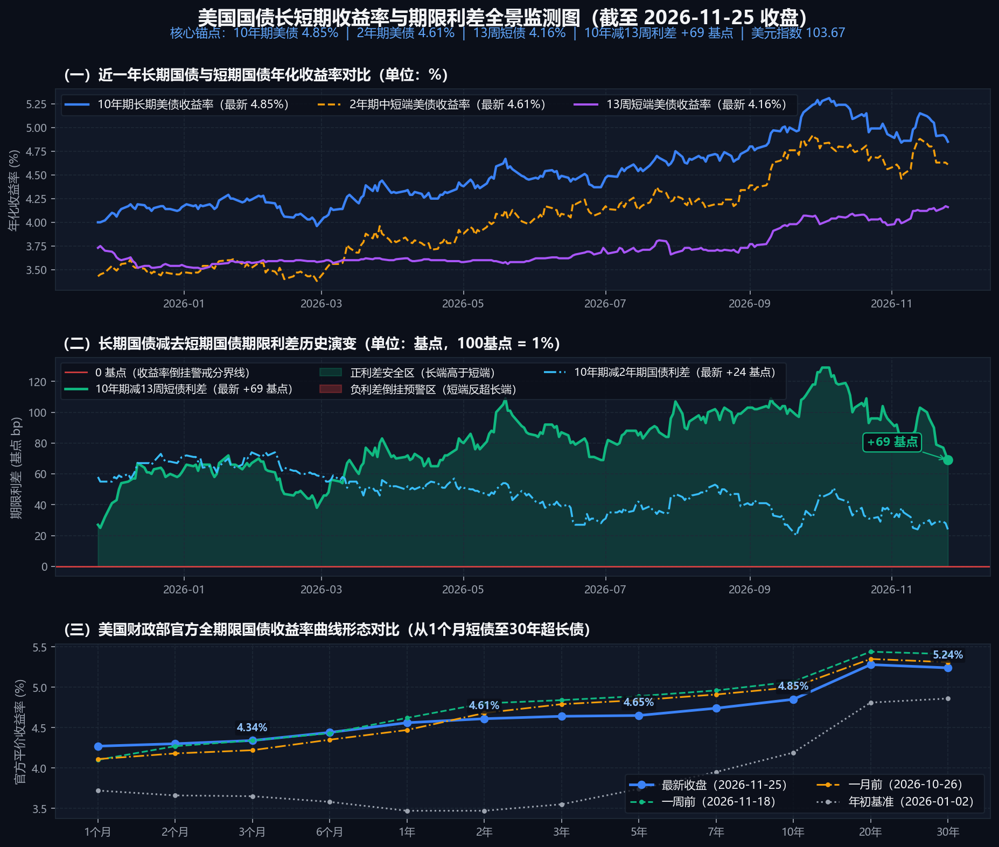

# 美股纳斯达克科技股与核心指数每日投研报告（2026年11月25日）

> **美股交易日期与休市说明**：2026年11月26日（星期四）为美国感恩节法定假日，纽约证券交易所（NYSE）与纳斯达克（Nasdaq）全天休市；11月27日（星期五）为节后半日交易（美东 13:00 提前收盘）。截至当前北京时间 2026年11月27日午间，美股最近一个已收盘交易日为 **2026年11月25日（星期三）**。  
> **数据与信源口径**：行情与均线波动指标采自雅虎财经日线收盘数据；宏观与监管政策采自央行、部委及美国证监会法定公告（详见专栏文件 [2026-11-25_官方宏观与政策资讯.md](../资讯栏目/2026-11-25_官方宏观与政策资讯.md)）  
> **指标计算说明**：近5日与近20日涨跌幅分别统计最近5个、20个美股交易日累计表现；年初至今涨跌幅以2025年最后一个交易日收盘价为基准；量比（相对成交量）为当日成交量除以过去20个交易日日均成交量。

---

## 一、市场核心综述

美东时间 2026年11月25日（星期三，感恩节休市前最后一个完整交易日），盘前美国经济分析局（BEA）公布的三季度 GDP 二次修正值大幅上修至 **+4.3%**、10月核心 PCE 物价指数同比录得 **+3.3%**，强劲增长与通胀粘性促使利率路径保持偏紧，美股科技与核心指数整体呈现**承压回落、结构分化**态势，综合市场情绪评分为 **28.9 分（极度恐慌（防御避险为主））**：

- **核心指数表现与跨市场轮动**：纳斯达克综合指数收报 **23,585.80**（**-0.62%**），纳斯达克100指数收报 **26,046.90**（**-0.64%**），费城半导体指数收报 **8,774.86**（**-0.65%**），标普500指数收报 **7,182.78**（**-0.25%**）；传统蓝筹与中小盘逆势走强，道琼斯工业平均指数上涨 **+0.33%** 收于 **50,182.95** 点，罗素2000指数涨 **+0.71%**，长端美债收益率回落（10年期美债下行 6 个基点至 **4.85%**，10年期减13周期限利差收窄至 **+69 个基点**）。
- **市场广度与期权波动分化**：19家核心科技股中 **7 家收涨（占比 36.8%）**；期权波动层面，标普500恐慌指数收于 **26.80**（单日 **-5.27%**），而纳指100波动率指数逆势走高 **+5.79%** 至 **38.53**，科技股相对大盘维持 **+11.73 点** 的高额外波动溢价；黑天鹅尾部偏度指数升至 **142.06**，显示机构针对极端下行风险的保护需求依然偏高。
- **领涨与领跌焦点**：软件网安与部分权重大盘股表现韧性，**脸书母公司（+3.40%）**、**高通（+2.24%）** 与 **帕兰提尔（+1.50%）** 领涨；存储与算力硬件继续承压，**美光科技（-4.53%，放量 1.47倍）**、**英伟达（-3.91%）** 与 **亚马逊（-3.12%）** 领跌。

---

## 二、四大核心基准指数表现对比

| 指数名称（代码） | 最新收盘点位 | 日内波动区间（最低 ~ 最高） | 单日涨跌 | 近5日涨跌 | 近20日涨跌 | 年初至今 | 20日均线（偏离度） | 50日均线（偏离度） | 200日均线（偏离度） | 量比 | 20日年化波动率 | 距52周高点 |
| :--- | ---: | :---: | ---: | ---: | ---: | ---: | ---: | ---: | ---: | ---: | ---: | ---: |
| **纳斯达克综合指数** (`^IXIC`) | 23,585.80 | 22,632.40 ~ 23,627.45 | **-0.62%** | -3.46% | -11.16% | +1.48% | 24,712.52 (-4.56%) | 25,978.69 (-9.21%) | 25,167.65 (-6.29%) | 1.17倍 | 42.45% | -14.92% |
| **纳斯达克100指数** (`^NDX`) | 26,046.90 | 24,970.66 ~ 26,081.65 | **-0.64%** | -3.94% | -12.63% | +3.16% | 27,406.92 (-4.96%) | 29,064.20 (-10.38%) | 28,090.98 (-7.28%) | 1.17倍* | 46.88% | -16.95% |
| **费城半导体指数** (`^SOX`) | 8,774.86 | 8,129.24 ~ 8,781.01 | **-0.65%** | -9.10% | -24.90% | +23.88% | 9,849.26 (-10.91%) | 11,207.64 (-21.71%) | 10,935.60 (-19.76%) | 不适用 | 97.61% | -40.12% |
| **标普500指数** (`^GSPC`) | 7,182.78 | 6,970.11 ~ 7,199.31 | **-0.25%** | -1.92% | -7.25% | +4.93% | 7,423.12 (-3.24%) | 7,602.53 (-5.52%) | 7,352.49 (-2.31%) | 0.98倍 | 31.68% | -8.44% |

> **指数口径补充说明**：`*` 数据源对纳斯达克100指数披露的单日成交股数统计口径与历史均量口径不一致，观察纳斯达克整体资金换手热度请以**纳斯达克综合指数**（成交 113.63亿股，量比 1.17倍）为准；费城半导体指数为纯价格指数，不含指数级成交量。

---

## 三、多维市场情绪与跨资产风向标

- **综合市场情绪定量评分**：**28.9 / 100 分** —— 当前状态判定为 **「极度恐慌（防御避险为主）」**
- **内部涨跌与均线温度**：19 家核心科技股中当日 **7 家上涨（占比 36.8%）**；站上20日均线 **3 家**，站上50日均线 **2 家**，站上200日牛熊分界线 **5 家**。
- 期权波动层面：标普500恐慌指数收于 26.80（单日 -5.27%），纳指100波动率指数收于 38.53，科技股相对大盘仍保有 +11.73 点的额外波动溢价。
- 尾部风险层面：黑天鹅偏度指数报 142.06，显示机构防范极端尾部暴跌的对冲需求偏高。
- 利率与美债层面：10年期美债收益率报 4.85%，10年期减13周美债期限利差为 +69 个基点，收益率曲线维持正斜率（未倒挂）。
- 跨资产信用层面：高收益公司债与长期国债比值报 0.9304（单日 -0.80%），长端国债表现强于高收益债，债市资金偏向防御避险。
- **长短期国债利差可视化专刊**：已同步生成最新长短端收益率与期限利差走势图及全期限曲线分析（详见专题报告 [2026-11-25_美债期限利差专题分析.md](../国债利差专题/2026-11-25_美债期限利差专题分析.md) 与交互看板 [美债期限利差看板.html](../交互式看板/美债期限利差看板.html)）。

| 情绪维度分类 | 中文指标名称（代码） | 最新数值 | 单日涨跌幅 | 近5日涨跌幅 | 看盘实战解读 |
| :--- | :--- | ---: | ---: | ---: | :--- |
| 期权恐慌与波动 | **标普500恐慌指数** (`^VIX`) | 26.80 | **-5.27%** | -5.77% | 数值越高代表市场避险恐慌越重，低于20偏乐观，高于30属恐慌区间 |
| 期权恐慌与波动 | **纳指100波动率指数** (`^VXN`) | 38.53 | **+5.79%** | +16.33% | 专门衡量纳斯达克科技权重股的隐含波动与期权对冲热度 |
| 期权恐慌与波动 | **黑天鹅尾部偏度指数** (`^SKEW`) | 142.06 | +2.08% | -0.55% | 衡量机构买入极端暴跌保护期权的意愿，高于140提示尾部防范升温 |
| 汇率与全球流动性 | **美元指数** (`DX-Y.NYB`) | 103.68 | +0.01% | -0.21% | 反映美元对主要货币强弱，走强往往压制跨国科技股海外折算收益 |
| 利率与美联储预期 | **13周美债收益率** (`^IRX`) | 4.16% | -0.31% | +0.24% | 紧贴美联储近期基准利率预期的短端资金利率指标 |
| 利率与美联储预期 | **5年期美债收益率** (`^FVX`) | 4.66% | -1.10% | -4.59% | 反映市场对未来中期利率路径与信贷成本的定价 |
| 利率与美联储预期 | **10年期美债收益率** (`^TNX`) | 4.85% | -1.14% | -4.30% | 全球科技股估值折现之锚，收益率上行直接压制高估值成长股 |
| 利率与美联储预期 | **30年期美债收益率** (`^TYX`) | 5.24% | -1.08% | -3.27% | 反映超长期经济增长、通胀粘性与财政发债供给压力 |
| 避险与通胀预期 | **纽约黄金期货** (`GC=F`) | 3,652.70 | **+3.31%** | -0.89% | 衡量央行购金、地缘避险需求及实际利率预期 |
| 避险与通胀预期 | **纽约原油期货** (`CL=F`) | 85.67 | +2.38% | +2.96% | 衡量能源通胀输入压力与全球工业活动景气度 |
| 流动性与风险偏好 | **比特币价格** (`BTC-USD`) | 61,450.13 | +1.78% | +2.26% | 全天候交易的高弹性风险资产，反映全球投机流动性松紧 |
| 跨市场广度与轮动 | **罗素2000小盘股指数** (`^RUT`) | 2,704.06 | +0.71% | -0.38% | 反映美国本土中小市值企业表现及内需风险偏好 |
| 跨市场广度与轮动 | **道琼斯工业平均指数** (`^DJI`) | 50,182.95 | +0.33% | -0.03% | 反映传统工业、金融与消费蓝筹股表现，用于对比科技与价值轮动 |
| 债市信用风险偏好 | **高收益公司债基金** (`HYG`) | 76.52 | +0.12% | -0.17% | 代表高风险企业信用债价格，走强意味着资金愿意承担信用风险 |
| 债市信用风险偏好 | **20年期以上长端美债基金** (`TLT`) | 82.24 | +0.92% | +2.52% | 代表长期国债避险资产价格，与高收益债比值可量化风险偏好 |

---

## 四、官方宏观政策与国际经贸权威资讯精要（零小道消息）

> 完整部委、央行与证监会法定原文链接及深度拆解已归档至专栏文件：[2026-11-25_官方宏观与政策资讯.md](../资讯栏目/2026-11-25_官方宏观与政策资讯.md)。

- **纽约联储官方资金利率**：最新联邦基金有效利率（EFFR）报 **3.88%**（生效日 2026-11-24），担保隔夜融资利率（SOFR）报 **3.94%**，货币市场隔夜资金价格维持平稳。
- **[2026-11-25｜美国经济分析局（BEA）宏观数据]** 三季度实际 GDP 二次修正值年化季率大幅上修至 **+4.3%**（初值 3.4%，企业利润环比增 2,060 亿美元、同比 +21.3%）；10月整体 PCE 物价指数环比 **+0.3%**、同比升至 **+3.8%**，美联储重点锚定的**核心 PCE 物价指数环比 +0.3%、同比达 +3.3%**（实际 PCE 环比微降），增长韧性与通胀粘性使12月8–9日 FOMC 会议维持偏紧预期。
- **[2026-11-25｜美联储官方致辞与贴现率纪要]** 美联储负责监管的副主席鲍曼（Michelle W. Bowman）发表《实现银行监管现代化：美洲共同议程》演讲，强调监管应聚焦实质风险防范并适配 AI 与数字资产演进；此外11月24日公布的贴现率纪要显示，10月议息前 **12 家地区联储中有 8 家曾建议上调初级信贷利率 25 基点**。
- **[2026-11-25｜商务部 BIS 实体清单与 USTR 301 关税执法]** 美国商务部工业与安全局（BIS）正式刊印最终规则（`2026-23999`），将马来西亚、新加坡与泰国 **7 家涉先进计算芯片转运风险实体** 列入实体清单（适用“推定拒绝”）；同日美国贸易代表办公室（USTR）就制造业结构性产能过剩对 **14 个经济体** 作出 301 调查肯定性认定并提出差异化拟议加征关税方案（最高税率 15%~35%），同时就对巴西 301 行动提出额外食糖与 10% 成品飞机关税修改方案，并在北京共同主持中美贸易委员会农业工作组首次会议。
- **[2026-11-23~25｜美国证监会法定公司披露]** **众击安全（CRWD）** 连续提交 `425` 与 `8-K` 推进约 439 亿美元全股票收购 Zscaler 并披露季报；**高通（QCOM）** `8-K` 披露高管 5 年期股价挂钩绩效激励；**谷歌母公司（GOOGL）** `8-K` 披露完成 60 亿加元优先票据交割；**英伟达（NVDA）** 11月23日 `8-K` 恢复黄仁勋总裁兼 CEO 职务；**脸书母公司（META）** 11月23日 `8-K` 披露股东重组诉讼和解细节（审前不发行 C 类普通股）。

---

## 五、核心科技股表现与技术面分板块明细

以下按三大科技子板块分类，组内均按**单日涨跌幅从高到低**排序：

### （一）科技七巨头

| 公司名称（代码） | 收盘价（美元） | 单日涨跌 | 近5日涨跌 | 近20日涨跌 | 年初至今 | 当日成交量 | 量比 | 较20日均线 | 较50日均线 | 较200日均线及趋势位置 | 20日年化波动率 | 距52周高点 |
| :--- | ---: | ---: | ---: | ---: | ---: | ---: | ---: | ---: | ---: | :--- | ---: | ---: |
| **脸书母公司** (`META`) | 609.89 | **+3.40%** | -1.05% | -0.42% | -7.61% | 1866.82万股 | 0.98倍 | -0.87% | -9.30% | -2.81%｜处于20日、50日与200日三重均线下方 | 48.9% | -21.79% |
| **苹果** (`AAPL`) | 355.58 | **+0.43%** | +0.89% | +3.42% | +30.80% | 5428.53万股 | 1.07倍 | +1.98% | +3.65% | +16.81%｜站稳短中长期全部均线 | 28.9% | -1.45% |
| **特斯拉** (`TSLA`) | 380.14 | **-1.18%** | -0.93% | -5.96% | -15.47% | 3491.58万股 | 0.98倍 | -0.53% | +0.79% | -0.26%｜处于20日、50日与200日三重均线下方 | 72.7% | -23.79% |
| **微软** (`MSFT`) | 489.93 | **-1.25%** | -3.61% | -7.74% | +1.30% | 2675.95万股 | 0.87倍 | -5.26% | -5.70% | +10.13%｜守住200日牛熊分界线，受制于20日与50日均线 | 38.9% | -12.38% |
| **谷歌母公司** (`GOOGL`) | 273.10 | **-2.13%** | -3.31% | -15.94% | -12.75% | 4128.37万股 | 0.89倍 | -3.51% | -14.18% | -18.80%｜处于20日、50日与200日三重均线下方 | 58.6% | -33.16% |
| **亚马逊** (`AMZN`) | 244.43 | **-3.12%** | -8.71% | -3.99% | +5.90% | 6247.95万股 | 1.16倍 | -4.96% | -4.19% | -0.55%｜处于20日、50日与200日三重均线下方 | 46.9% | -14.89% |
| **英伟达** (`NVDA`) | 149.30 | **-3.91%** | -1.10% | -30.68% | -19.95% | 3.67亿股 | 1.09倍 | -13.44% | -26.69% | -26.41%｜处于20日、50日与200日三重均线下方 | 138.0% | -38.65% |

### （二）半导体与芯片设备

| 公司名称（代码） | 收盘价（美元） | 单日涨跌 | 近5日涨跌 | 近20日涨跌 | 年初至今 | 当日成交量 | 量比 | 较20日均线 | 较50日均线 | 较200日均线及趋势位置 | 20日年化波动率 | 距52周高点 |
| :--- | ---: | ---: | ---: | ---: | ---: | ---: | ---: | ---: | ---: | :--- | ---: | ---: |
| **高通** (`QCOM`) | 168.66 | **+2.24%** | +5.54% | -7.82% | -1.40% | 1405.44万股 | 0.91倍 | +0.72% | -4.30% | -1.35%｜短线站上20日均线，上方中长期均线承压 | 81.0% | -35.11% |
| **博通** (`AVGO`) | 300.86 | **-0.07%** | -15.02% | -14.48% | -13.07% | 3434.95万股 | 1.08倍 | -7.99% | -11.66% | -18.09%｜处于20日、50日与200日三重均线下方 | 83.3% | -39.22% |
| **英特尔** (`INTC`) | 54.47 | **-0.60%** | -0.37% | -42.98% | +47.62% | 1.29亿股 | 0.81倍 | -8.24% | -37.89% | -37.86%｜处于20日、50日与200日三重均线下方 | 142.5% | -61.74% |
| **超威半导体** (`AMD`) | 406.03 | **-1.75%** | -23.41% | -29.81% | +89.59% | 5163.20万股 | 1.14倍 | -17.00% | -25.95% | -6.22%｜处于20日、50日与200日三重均线下方 | 133.2% | -38.34% |
| **阿斯麦** (`ASML`) | 1,303.08 | **-2.47%** | -6.61% | -21.64% | +21.80% | 205.63万股 | 1.08倍 | -10.06% | -19.05% | -18.57%｜处于20日、50日与200日三重均线下方 | 72.4% | -34.84% |
| **美光科技** (`MU`) | 601.25 | **-4.53%** | -14.75% | -38.85% | +110.66% | 5298.84万股 | **1.47倍** | -19.06% | -32.86% | -22.57%｜处于20日、50日与200日三重均线下方 | 133.2% | -52.09% |

### （三）软件、云计算与网络安全

| 公司名称（代码） | 收盘价（美元） | 单日涨跌 | 近5日涨跌 | 近20日涨跌 | 年初至今 | 当日成交量 | 量比 | 较20日均线 | 较50日均线 | 较200日均线及趋势位置 | 20日年化波动率 | 距52周高点 |
| :--- | ---: | ---: | ---: | ---: | ---: | ---: | ---: | ---: | ---: | :--- | ---: | ---: |
| **帕兰提尔** (`PLTR`) | 163.59 | **+1.50%** | +4.42% | -16.88% | -7.97% | 2148.60万股 | 0.83倍 | -1.64% | -10.38% | +6.02%｜守住200日牛熊分界线，受制于20日与50日均线 | 71.8% | -23.18% |
| **奈飞** (`NFLX`) | 59.41 | **+0.92%** | -0.69% | -4.16% | -36.64% | 4575.65万股 | 1.14倍 | -3.68% | -10.31% | -25.36%｜处于20日、50日与200日三重均线下方 | 33.0% | -45.86% |
| **派拓网络** (`PANW`) | 356.14 | **+0.89%** | +4.77% | -9.72% | +93.34% | 669.09万股 | 0.83倍 | +4.83% | -2.74% | +25.29%｜站稳20日与200日均线，挑战50日均线 | 69.5% | -17.62% |
| **奥多比** (`ADBE`) | 232.83 | **+0.32%** | +2.93% | -6.78% | -33.48% | 375.26万股 | 0.95倍 | -2.16% | -3.80% | -5.28%｜处于20日、50日与200日三重均线下方 | 33.0% | -35.81% |
| **众击安全** (`CRWD`) | 209.30 | **-0.74%** | -11.70% | -21.51% | +78.60% | 1457.17万股 | **1.27倍** | -8.90% | -14.66% | +17.71%｜守住200日牛熊分界线，受制于20日与50日均线 | 66.5% | -27.07% |
| **新思科技** (`SNPS`) | 405.09 | **-2.35%** | -6.66% | -15.94% | -13.76% | 179.62万股 | 1.02倍 | -9.30% | -10.15% | -8.07%｜处于20日、50日与200日三重均线下方 | 52.8% | -24.91% |

> **全样本涨跌极值榜**：领涨前五依次为 **脸书母公司 (+3.40%) > 高通 (+2.24%) > 帕兰提尔 (+1.50%) > 奈飞 (+0.92%) > 派拓网络 (+0.89%)**；表现靠后五家依次为 **美光科技 (-4.53%) < 英伟达 (-3.91%) < 亚马逊 (-3.12%) < 阿斯麦 (-2.47%) < 新思科技 (-2.35%)**。

---

## 六、子板块轮动与市场广度量化分析

| 子板块名称 | 样本数 | 上涨家数（占比） | 等权单日均值 | 单日中位数 | 等权近5日均值 | 等权近20日均值 | 等权年初至今均值 | 站上20日均线 | 站上50日均线 | 站上200日均线 |
| :--- | :---: | :---: | ---: | ---: | ---: | ---: | ---: | :---: | :---: | :---: |
| 半导体与芯片设备 | 6 | 1 / 6 (16.7%) | **-1.20%** | -1.18% | -9.10% | -25.93% | +42.53% | 1 / 6 (16.7%) | 0 / 6 (0.0%) | 0 / 6 (0.0%) |
| 科技七巨头 | 7 | 2 / 7 (28.6%) | **-1.11%** | -1.25% | -2.55% | -8.76% | -2.54% | 1 / 7 (14.3%) | 2 / 7 (28.6%) | 2 / 7 (28.6%) |
| 软件、云计算与网安 | 6 | 4 / 6 (66.7%) | **+0.09%** | +0.60% | -1.16% | -12.50% | +13.35% | 1 / 6 (16.7%) | 0 / 6 (0.0%) | 3 / 6 (50.0%) |
| **全部19家核心科技股合计** | 19 | 7 / 19 (36.8%) | **-0.76%** | -0.74% | -4.18% | -15.36% | +16.71% | 3 / 19 (15.8%) | 2 / 19 (10.5%) | 5 / 19 (26.3%) |

1. **子板块强弱分化延续：软件与网安连续两日领跑，半导体延续磨底**：**软件、云计算与网安板块** 6 家样本中有 4 家收涨（占比 66.7%），等权单日微涨 **+0.09%**（中位数 +0.60%），其中帕兰提尔（+1.50%）、奈飞（+0.92%）、派拓网络（+0.89%）录得正收益；**科技七巨头** 2 涨 5 跌，等权下跌 **-1.11%**，仅脸书母公司（+3.40%）与苹果（+0.43%）收红；**半导体与芯片设备板块** 1 涨 5 跌，等权下跌 **-1.20%**，仅高通（+2.24%）收涨，近20日板块累计等权回撤达 **-25.93%**。
2. **短中期均线站上率处于低位，200日牛熊线仅守住 5 席**：全样本 19 家科技股中仅 **3 家（15.8%）** 站上20日均线（苹果、高通、派拓网络），仅 **2 家（10.5%）** 站上50日均线（苹果、特斯拉），**5 家（26.3%）** 仍运行于200日牛熊分界线之上（苹果 +16.81%、微软 +10.13%、派拓网络 +25.29%、众击安全 +17.71%、帕兰提尔 +6.02%），半导体板块在50日与200日均线上方家数依然为 `0 / 6`。

---

## 七、成交量异动与均线结构信号

### （一）显著放量异动个股（20日量比 ≥ 1.25倍）

- **美光科技（MU｜量比 1.47倍｜单日 -4.53%）**：成交 **5,298.84 万股**，连续两日放量下跌（前日 -11.01%），收盘价（601.25 美元）处于20日、50日与200日三重均线下方，近20日回撤 -38.85%、距52周高点回撤达 -52.09%，短期抛压尚未出清。
- **众击安全（CRWD｜量比 1.27倍｜单日 -0.74%）**：成交 **1,457.17 万股**，连续三个交易日维持放量换手，盘中继续消化并购 Zscaler 换股摊薄预期，收盘（209.30 美元）稳守200日牛熊分界线（+17.71%）上方。

### （二）关键均线攻防与波动率警示

- **均线结构与唯一全均线多头标的**：19 家样本中仅有 **苹果（AAPL，+0.43%，较20/50/200日均线分别为 +1.98% / +3.65% / +16.81%，距52周高点仅 -1.45%）** 站稳全部短中长期均线；**派拓网络（PANW，+0.89%）** 站稳20日与200日均线，距离收复50日均线（-2.74%）仅一步之遥；**特斯拉（TSLA，-1.18%）** 跌破20日与200日均线边缘，短期多空胶着。
- **指数均线偏离与芯片极端波动**：纳斯达克综合指数较20日均线偏离 **-4.56%**、较50日均线偏离 **-9.21%**；费城半导体指数20日年化波动率维持 **97.61%** 的极高水位，英特尔（142.5%）、英伟达（138.0%）、超威半导体（133.2%）、美光科技（133.2%）波动率均超过 130%。

---

## 八、重点个股催化剖析与短期风险展望

### （一）重点异动个股驱动逻辑（区分法定事实与市场博弈）

- **脸书母公司（META｜+3.40%，量比 0.98倍）**：11月23日提交 `8-K` 公告披露就重组及 C 类股股息合并股东诉讼达成和解方案（审前程序期间不再发行 C 类普通股），消除部分股权结构不确定性；叠加前两周连跌后的技术面超跌回补，领涨科技七巨头。
- **高通（QCOM｜+2.24%，量比 0.91倍）**：11月24日提交 `8-K` 披露向 CEO 与 CFO/COO 授予与 250~500 美元股价目标挂钩的五年期绩效股权激励（PSU），成为当日半导体板块唯一收涨标的并重回20日均线上方（+0.72%）。
- **帕兰提尔（PLTR｜+1.50%，量比 0.83倍）与派拓网络（PANW｜+0.89%，量比 0.83倍）**：延续软件与网安板块防御轮动，其中派拓网络此前于11月18日发布 `8-K` 季报并稳居200日均线上方 +25.29%。
- **英伟达（NVDA｜-3.91%，量比 1.09倍）与美光科技（MU｜-4.53%，量比 1.47倍）**：尽管英伟达于11月23日提交 `8-K` 正式恢复黄仁勋总裁兼首席执行官职务并在此前（11月17日）披露三季度财报，但受商务部 BIS 连续落地远程算力新规与东南亚7家实体清单（`2026-23999`）管制收紧、以及10月核心 PCE 同比升至 3.3% 压制高估值算力芯片影响，短线仍面临高波动反复筑底与筹码换手。
- **众击安全（CRWD｜-0.74%，量比 1.27倍）**：11月25日继续向证监会提交 `425` 并购沟通文件推进 Zscaler 换股合并，成交量保持活跃。

### （二）短期交易窗口与核心风险展望

1. **关注感恩节后半日交投及12月8–9日 FOMC 议息窗口**：11月26日美股休市、11月27日仅半日交易（美东 13:00 收盘），节假日前后流动性清淡易放大波动；11月25日 BEA 公布的 Q3 GDP（4.3%）与 10月核心 PCE（3.3%）数据强化了美联储在12月8–9日会议前维持紧缩警惕的依据，需紧盯10年期美债收益率（4.85%）是否再度逼近 5.0% 关口。
2. **追踪 USTR 301 关税拟议与 BIS 出口管制外溢冲击**：USTR 11月25日针对14个经济体制造业产能过剩的 301 肯定性认定及拟议关税清单，叠加 BIS 东南亚实体清单与远程算力规则，对跨国硬件、半导体设备及云基建供应链存在中期合规与关税成本扰动。
3. **观察芯片与高弹性软件的均线收复节奏**：当前 19 只样本中仅 3 家站上20日均线，在纳指100波动率（VXN 38.53）未回落至 30 以下之前，建议严格控制高年化波动率标的（>100%）仓位。

---

## 九、初学者投研术语通俗伴读

> 以下词条由系统根据今日报告正文自动识别生成，帮助初学者无障碍读懂专业数据。当前已设置免解释的名词共 **0** 个；今后若某个名词您已完全熟悉、不再需要解释，只需直接告诉我（例如“以后不用解释均线和量比了”），系统便会将其写入《术语配置.json》永久跳过。

| 所属类别 | 专业术语名称 | 通俗中文解释 | 看盘实战意义 |
| :--- | :--- | :--- | :--- |
| 宏观与货币政策 | **美联储与联邦公开市场委员会（FOMC）** | 美联储是美国的中央银行，而联邦公开市场委员会（简称 FOMC）是美联储内部专门决定“美元基准利率涨跌”的核心决策机构，每年通常召开 8 次例会。 | 全球资金成本都看它脸色：一旦委员会态度强硬（市场俗称“鹰派”），意味着利率可能维持高位甚至继续加息，科技股往往承压；态度温和（俗称“鸽派”），则利好科技股估值扩张。 |
| 宏观与货币政策 | **加息、降息与联邦基金利率** | 联邦基金利率是美国商业银行之间隔夜拆借美元的基准利率。调高该利率即“加息”，意在给过热经济和物价降温；调低即“降息”（或减息），意在降低企业和个人借钱成本、刺激经济。 | 科技成长股大量利润来自未来数年，利率越高，未来利润折算到今天的价值就越低。因此“预期加息”通常压制纳斯达克，“预期降息”则提振纳斯达克。 |
| 宏观与货币政策 | **基点（bp）** | 金融市场用来衡量利率微幅变动的最小常用单位。1 个基点等于 0.01%（即万分之一），100 个基点等于 1 个百分点（1%）。 | 例如常说的“美联储加息 25 个基点”，就是把基准利率上调 0.25%；“美债收益率跳升 10 个基点”，代表借债成本上升了 0.10%。 |
| 宏观与货币政策 | **10年期美债收益率** | 投资者购买并持有美国政府 10 年期国债所能获得的年化回报率，被华尔街公认为“全球资产定价之锚”。 | 由于美国国债几乎没有违约风险，当 10 年期美债收益率接近或突破 5% 时，大量稳健资金会觉得“躺赚 5% 利息很划算”，从而减少对高估值科技股的配置。 |
| 宏观与货币政策 | **美债期限利差（收益率曲线与倒挂）** | 用长期国债收益率减去短期国债收益率得到的差值（常见有“10年期减13周短债”和“10年期减2年期国债”）。正常情况下借钱时间越长，要求的利息补偿越高，利差为正数；若短期利率反超长期利率（利差变成负数），就叫“收益率倒挂”。 | 利差保持正数且温和走阔，通常说明市场预期经济维持正增长或长期通胀有溢价；若利差由正转负陷入深度倒挂，历史上往往是美联储加息过猛、未来经济面临降温甚至衰退的经典预警。 |
| 宏观与货币政策 | **美元指数** | 综合反映美元在国际外汇市场上对欧元、日元、英镑等一篮子主要货币强弱程度的指标。 | 苹果、英伟达、微软等纳斯达克巨头有一半左右收入来自海外。美元指数过强不仅代表全球美元回流美国本土、新兴市场承压，也会让跨国科技公司的海外收入换算回美元时缩水。 |
| 国际经贸与监管 | **出口管制、工业与安全局（BIS）及实体清单** | 美国商务部下属的工业与安全局负责管理高科技产品出口许可。被列入“实体清单”或受限地区的海外机构，未经美国政府特别批准，无法购买美国高端芯片、软件或租用受限的远程云计算算力。 | 半导体公司（如英伟达、超威半导体、阿斯麦等）在海外拥有可观收入，出口管制范围的收紧或放宽会直接影响它们的订单预期。 |
| 国际经贸与监管 | **美国证监会 8-K 重大事项法定公告** | 美国证券交易委员会规定，美股上市公司一旦发生可能显著影响股价的重大事件（如收购兼并、核心高管辞职或复职、正式发布财报等），必须在 4 个工作日内提交的官方披露文件。 | 相比社交媒体传闻或小道消息，8-K 文件具有严格法律效力，造假需承担刑事责任，是核实公司重大变动的最高权威一手信源。 |
| 市场情绪与交易机制 | **恐慌指数（VIX）与纳指波动率指数（VXN）** | 通过期权价格推算出来的未来 30 天市场预期波动幅度。VIX 对应标普500大盘，VXN 则专门对应纳斯达克100科技股。 | 数值越低（如低于 18）代表市场平静乐观；突破 25 代表市场紧张不安；突破 35 往往代表极度恐慌抛售。当恐慌指数从高位单日暴跌逾 20% 时，通常意味着恐慌警报暂时解除、资金大举回流股市。 |
| 市场情绪与交易机制 | **黑天鹅偏度指数（SKEW）** | 衡量机构投资者在期权市场上花多少钱购买“防范大盘极端暴跌”保险的指标，正常区间通常在 100 至 135 之间。 | 当该数值升至 140 以上时，说明尽管指数可能在涨，华尔街大资金暗地里仍在加买“防暴跌保险”，提示需留一份清醒。 |
| 市场情绪与交易机制 | **信用风险偏好比值（高收益债与长端国债比值）** | 比较“高收益企业债基金（HYG，风险较高、利息高）”与“长期美国国债基金（TLT，安全避险）”的价格比值。 | 债市资金往往比股市更敏锐：比值上升说明聪明钱愿意承担企业违约风险、整体市场偏向进攻；比值大跌则说明资金正在撤退回国债避险。 |
| 市场情绪与交易机制 | **市场广度（上涨家数占比）** | 统计指数上涨时，内部究竟是“绝大多数成分股一起涨”，还是“只有两三只超级大盘股拉动指数、其余股票都在跌”。 | 健康的上涨需要高市场广度（如超过 70%~80% 的股票同步上涨且站上均线）；若只有少数权重股独涨，行情通常走不远。 |
| 市场情绪与交易机制 | **高弹性股票（高贝塔 / 高 Beta）** | 衡量个股相对大盘涨跌放大倍数的指标。大盘涨 1% 时往往能涨 2%~3%、大盘跌 1% 时也跌得更猛的股票，称为高弹性（高贝塔）标的，典型代表如半导体、人工智能软件股。 | 当市场情绪转暖反攻时，高弹性股票是冲锋主力；当市场避险下跌时，稳健型股票（如苹果）则更抗跌。 |
| 技术分析与量化指标 | **移动平均线（20日、50日、200日均线）与均线偏离度** | 把过去 20 个、50 个或 200 个交易日的收盘价算出的平均价格，分别代表短期（约一个月）、中期（约一个季度）和长期（约一年）的市场平均持仓成本。当前股价高于或低于均线的百分比即为“均线偏离度”。 | 股价站上均线说明近期买入的人普遍赚钱，均线会形成支撑；反之股价跌破均线，上方套牢盘在反弹到均线附近时容易卖出解套，均线就变成了阻力位。其中 200 日均线常被称为“牛熊分界线”。 |
| 技术分析与量化指标 | **相对成交量（量比）** | 当日成交股数除以过去 20 个交易日平均每日成交股数的倍数。1.0 倍代表成交平平；超过 1.25 倍代表明显放量；超过 2 倍以上属于巨量异动。 | 俗话说“股市里什么都能骗人，唯独成交量不会”：放量大涨说明真金白银在抢筹，放量大跌则说明机构资金正在集中撤离。 |
| 技术分析与量化指标 | **20日年化波动率** | 根据最近 20 个交易日每天涨跌幅的剧烈程度，按全年约 252 个交易日折算出的年度价格摆动幅度指标。 | 普通稳健大盘股的年化波动率多在 20%~35% 左右；如果某只股票年化波动率高达 100% 以上，说明它近期每天暴涨暴跌如同过山车，仓位控制必须格外谨慎。 |
| 技术分析与量化指标 | **距52周高点回撤** | 当前收盘价相比过去一年（52周）最高价格下跌了多少百分比。 | 通常回撤在 10% 以内属于正常震荡，回撤 10%~20% 称为“技术性回调”，回撤超过 20% 则进入个股或板块层面的“技术性熊市/深度修正区间”。 |
