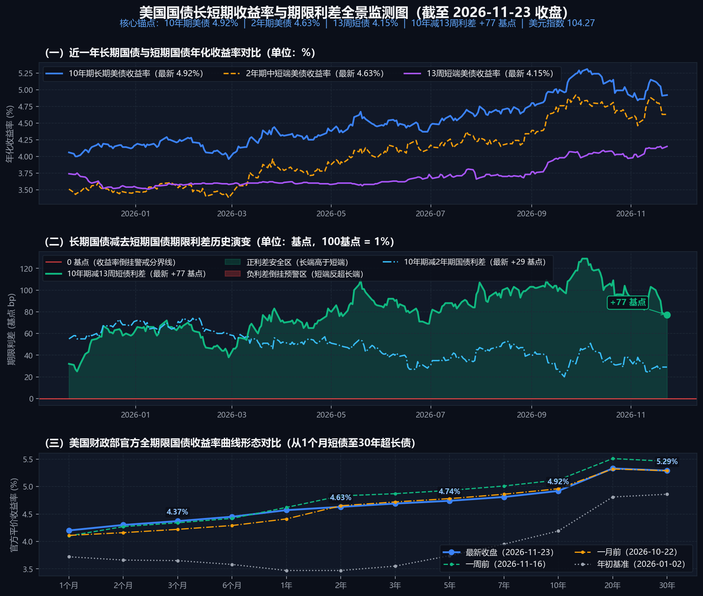

# 美国国债长短期期限利差量化计算与可视化专题报告（截至 2026-11-23）

> **官方锚点核验**：截至 **2026-11-23** 美股收盘，13周短端美债收益率为 **4.15%**，2年期美债收益率为 **4.63%**，10年期美债收益率为 **4.92%**，30年期美债收益率为 **5.29%**；核心**10年期减13周美债期限利差为 +77 个基点**（即 +0.77 个百分点），美元指数报 **104.27**。  
> **权威信源说明**：本算法仅采信**美国财政部官方每日国债收益率曲线表**与**雅虎财经二级市场官方基准指数**，杜绝一切非官方估算。

---

## 一、长短期国债期限利差全景可视化图

---

## 二、五大核心长短期美债利差实时计算总表

| 期限利差指标名称 | 计算公式（长期 − 短期） | 最新利差 | 单日变动 | 近5日变动 | 近20日变动 | 近一年最低 ~ 最高 | 近一年均值 | 近一年分位 | 近一年倒挂天数 | 当前曲线状态 |
| :--- | :--- | ---: | ---: | ---: | ---: | :---: | ---: | ---: | :---: | :--- |
| **10年期减13周短端美债利差（盘面核心锚点）** | 10年期美债（4.92%） − 13周短债贴现率（4.15%） | **+77 基点** | -2.0 基点 | -23.0 基点 | -19.0 基点 | +25 ~ +129 基点 | +80.0 基点 | 45.2% | 0 / 252 天 | 正利差（正常向上倾斜） |
| **10年期减2年期美债利差（华尔街经典基准）** | 10年期美债（4.92%） − 2年期美债（4.63%） | **+29 基点** | +0.0 基点 | +0.0 基点 | -3.0 基点 | +20 ~ +74 基点 | +48.3 基点 | 7.6% | 0 / 250 天 | 正利差（正常向上倾斜） |
| **10年期减3个月平价美债利差（联储衰退模型口径）** | 10年期平价美债（4.92%） − 3个月平价美债（4.37%） | **+55 基点** | -5.0 基点 | -23.0 基点 | -23.0 基点 | +8 ~ +109 基点 | +66.4 基点 | 28.4% | 0 / 250 天 | 正利差（正常向上倾斜） |
| **30年期减13周美债全曲线总利差** | 30年期美债（5.29%） − 13周短债贴现率（4.15%） | **+114 基点** | -4.0 基点 | -21.0 基点 | -13.0 基点 | +89 ~ +165 基点 | +133.1 基点 | 9.1% | 0 / 252 天 | 正利差（正常向上倾斜） |
| **30年期减10年期超长端期限溢价** | 30年期美债（5.29%） − 10年期美债（4.92%） | **+37 基点** | -2.0 基点 | +3.0 基点 | +6.0 基点 | +29 ~ +68 基点 | +52.6 基点 | 17.5% | 0 / 252 天 | 正利差（正常向上倾斜） |

> **口径差异贴心提示**：二级市场盘面指数 `^IRX`（4.15%）按 **360天贴现率口径** 报价，所得10年期减13周利差为 **+77 个基点**；而美国财政部官方每日曲线表中的3个月国债（4.37%）按 **365天平价债券等价收益率口径** 报价，同口径下10年期减3个月利差为 **+55 个基点**。两者方向一致、均处于显著正斜率区间。

---

## 三、收益率曲线四象限形态诊断与纳斯达克传导逻辑

1. **单日曲线变动形态**：**熊平（短端收益率上行更快、利差收窄）** —— 短期国债收益率升幅快于长期，通常反映美联储释放鹰派信号或短端降息预期降温，资金面趋紧。
2. **近20个交易日中期形态**：**熊平（短端收益率上行更快、利差收窄）** —— 短期国债收益率升幅快于长期，通常反映美联储释放鹰派信号或短端降息预期降温，资金面趋紧。
3. **对纳斯达克科技股的估值启示**：当前长短期美债收益率曲线整体保持向上倾斜（未出现衰退型深度倒挂），说明债市定价的核心逻辑并非“美国经济即将硬着陆衰退”，而是“经济增长具韧性叠加通胀粘性使美联储维持高利率更久”。在此格局下，10年期美债收益率（4.92%）与 5.00% 整数大关的距离，直接决定了科技巨头与高弹性芯片股的市盈率扩张上限；同时美元指数稳居 104.27 偏强水位，跨国科技企业海外汇兑环境维持中性偏紧。

---

## 四、初学者国债与利率术语通俗伴读

> 系统已自动提取本专题中可能较陌生的债券与利率名词（当前免解释屏蔽词数：**0** 个；若某词无需再解释，请随时告知我）。

1. **美联储与联邦公开市场委员会（FOMC）**（*宏观与货币政策*）
   - **通俗理解**：美联储是美国的中央银行，而联邦公开市场委员会（简称 FOMC）是美联储内部专门决定“美元基准利率涨跌”的核心决策机构，每年通常召开 8 次例会。
   - **实战影响**：全球资金成本都看它脸色：一旦委员会态度强硬（市场俗称“鹰派”），意味着利率可能维持高位甚至继续加息，科技股往往承压；态度温和（俗称“鸽派”），则利好科技股估值扩张。
2. **加息、降息与联邦基金利率**（*宏观与货币政策*）
   - **通俗理解**：联邦基金利率是美国商业银行之间隔夜拆借美元的基准利率。调高该利率即“加息”，意在给过热经济和物价降温；调低即“降息”（或减息），意在降低企业和个人借钱成本、刺激经济。
   - **实战影响**：科技成长股大量利润来自未来数年，利率越高，未来利润折算到今天的价值就越低。因此“预期加息”通常压制纳斯达克，“预期降息”则提振纳斯达克。
3. **基点（bp）**（*宏观与货币政策*）
   - **通俗理解**：金融市场用来衡量利率微幅变动的最小常用单位。1 个基点等于 0.01%（即万分之一），100 个基点等于 1 个百分点（1%）。
   - **实战影响**：例如常说的“美联储加息 25 个基点”，就是把基准利率上调 0.25%；“美债收益率跳升 10 个基点”，代表借债成本上升了 0.10%。
4. **10年期美债收益率**（*宏观与货币政策*）
   - **通俗理解**：投资者购买并持有美国政府 10 年期国债所能获得的年化回报率，被华尔街公认为“全球资产定价之锚”。
   - **实战影响**：由于美国国债几乎没有违约风险，当 10 年期美债收益率接近或突破 5% 时，大量稳健资金会觉得“躺赚 5% 利息很划算”，从而减少对高估值科技股的配置。
5. **美债期限利差（收益率曲线与倒挂）**（*宏观与货币政策*）
   - **通俗理解**：用长期国债收益率减去短期国债收益率得到的差值（常见有“10年期减13周短债”和“10年期减2年期国债”）。正常情况下借钱时间越长，要求的利息补偿越高，利差为正数；若短期利率反超长期利率（利差变成负数），就叫“收益率倒挂”。
   - **实战影响**：利差保持正数且温和走阔，通常说明市场预期经济维持正增长或长期通胀有溢价；若利差由正转负陷入深度倒挂，历史上往往是美联储加息过猛、未来经济面临降温甚至衰退的经典预警。
6. **收益率曲线形态演变（牛陡、熊陡、牛平、熊平）**（*宏观与货币政策*）
   - **通俗理解**：债券价格与收益率反向变动（收益率跌=债券涨=债牛；收益率涨=债券跌=债熊）。利差变大叫“变陡”，利差缩小叫“变平”。由此组合成四种常见状态：①牛陡（短端利率降得比长端更快，常见于降息预期升温）；②熊陡（长端利率涨得比短端更快，常见于通胀担忧或国债增发）；③牛平（长端利率降得比短端更快，常见于避险买盘涌入长债）；④熊平（短端利率涨得比长端更快，常见于美联储释放加息信号）。
   - **实战影响**：科技成长股最喜欢“牛陡”（降息预期带来流动性宽松），最怕“熊陡”（长端10年期美债收益率快速飙升直接杀估值）与“熊平”（美联储鹰派加息抽紧资金）。
7. **贴现率口径与平价债券等价收益率口径**（*宏观与货币政策*）
   - **通俗理解**：二级市场行情代码（如 ^IRX）对3个月期国库券采用“360天贴现率”报价，而美国财政部官网每日曲线表采用“365天平价债券等价收益率”报价，因此同一天财政部公布的3个月收益率通常会比行情贴现率高出约 15~22 个基点。
   - **实战影响**：看盘时只需保持前后口径统一即可：日常盘中盯盘常用“10年期美债（^TNX）减13周贴现率（^IRX）”，而做跨期限国债曲线研究则统一采用美国财政部官方平价收益率表。
8. **美元指数**（*宏观与货币政策*）
   - **通俗理解**：综合反映美元在国际外汇市场上对欧元、日元、英镑等一篮子主要货币强弱程度的指标。
   - **实战影响**：苹果、英伟达、微软等纳斯达克巨头有一半左右收入来自海外。美元指数过强不仅代表全球美元回流美国本土、新兴市场承压，也会让跨国科技公司的海外收入换算回美元时缩水。
9. **高弹性股票（高贝塔 / 高 Beta）**（*市场情绪与交易机制*）
   - **通俗理解**：衡量个股相对大盘涨跌放大倍数的指标。大盘涨 1% 时往往能涨 2%~3%、大盘跌 1% 时也跌得更猛的股票，称为高弹性（高贝塔）标的，典型代表如半导体、人工智能软件股。
   - **实战影响**：当市场情绪转暖反攻时，高弹性股票是冲锋主力；当市场避险下跌时，稳健型股票（如苹果）则更抗跌。
